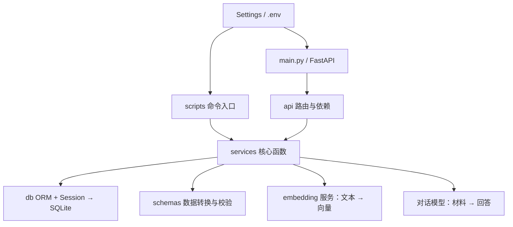
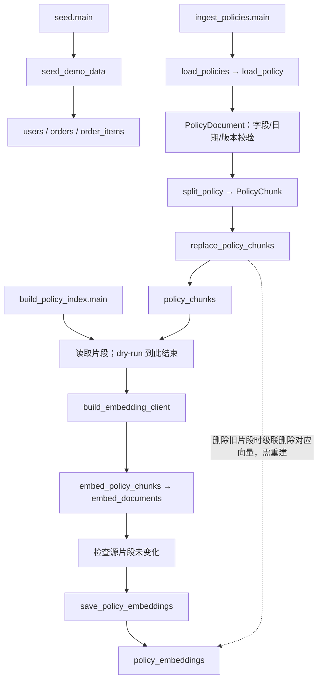
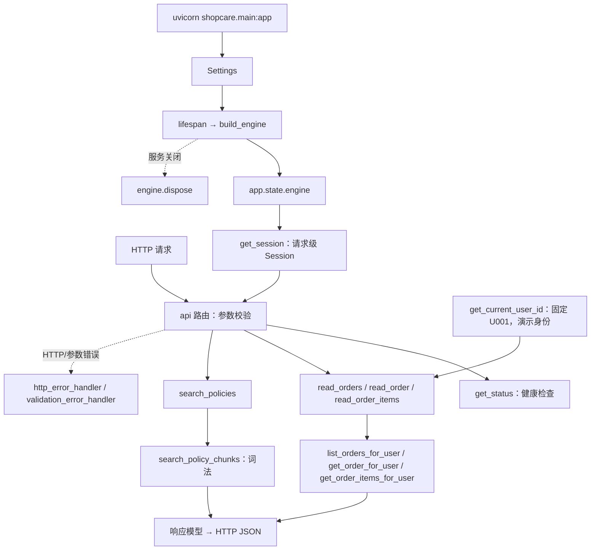
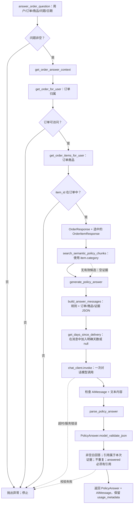
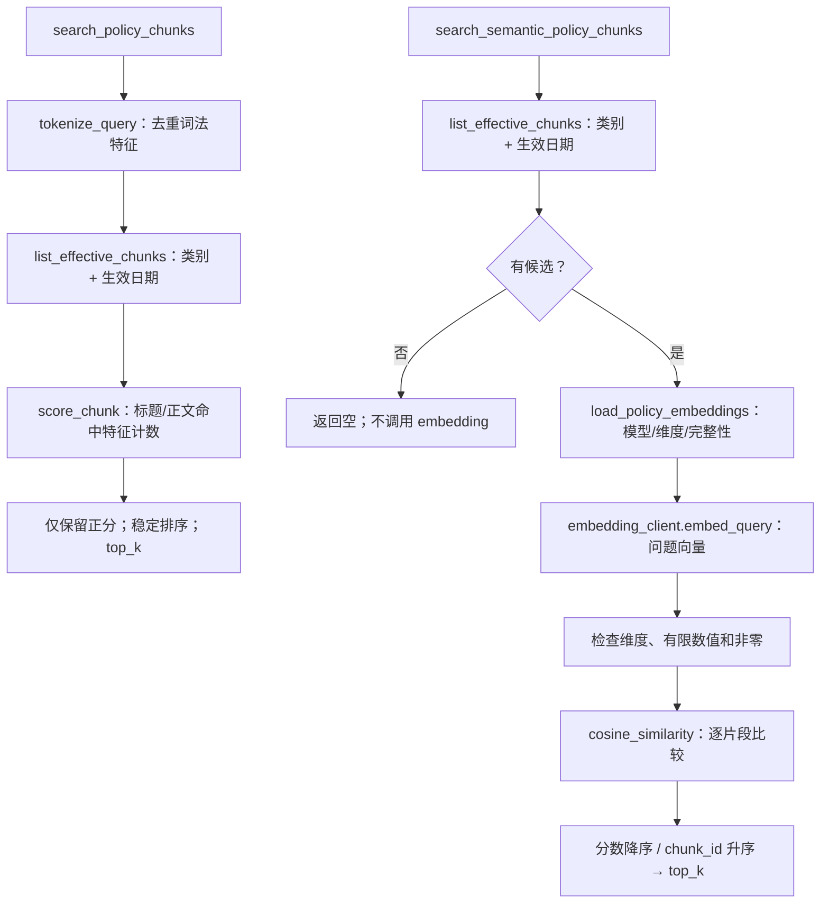
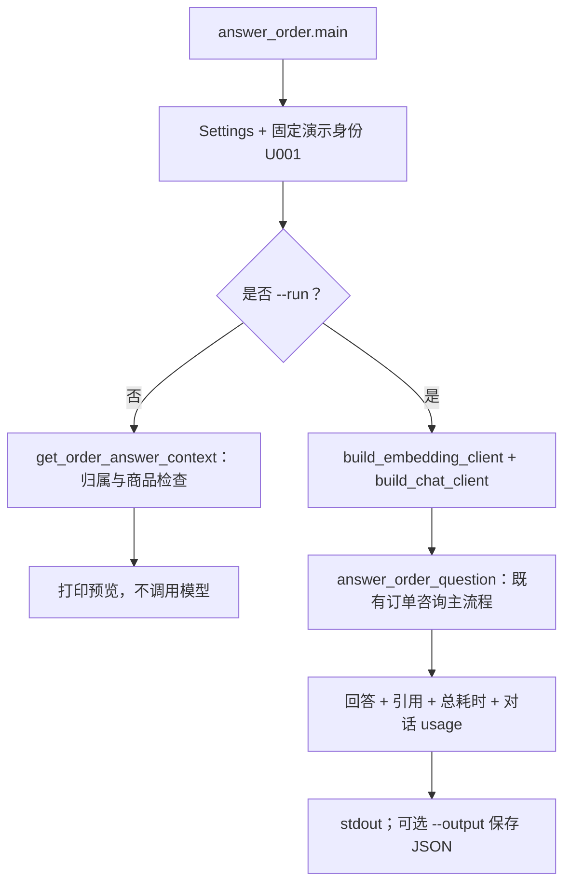
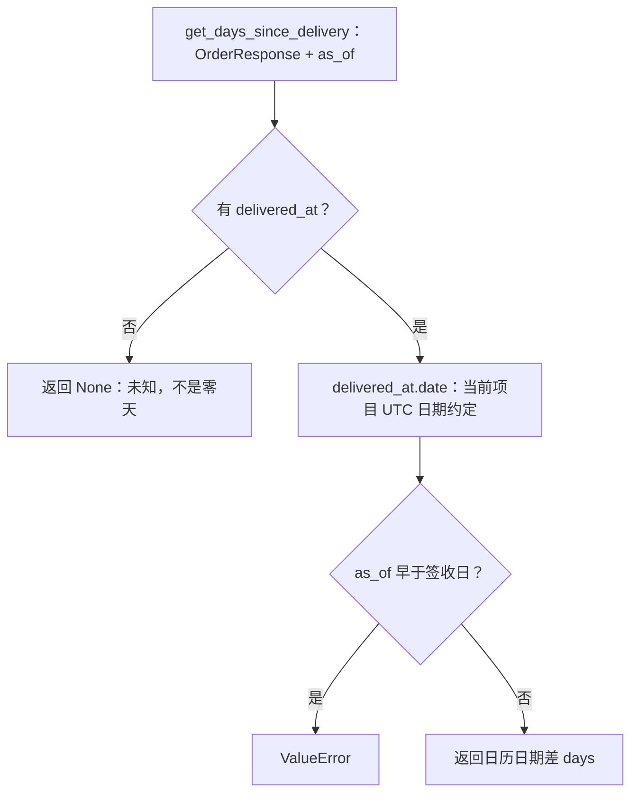

# ShopCare 结构与运行流程

核对日期：2026-10-31。图对应当前代码；新增函数时同步维护本文件的对应流程和函数清单。

## 当前状态

- 已运行验证：订单 API、词法检索 API、政策导入、向量构建、语义检索和十题真实对照。
- 本轮开发中：单次政策回答。消息构造、引用校验和生成函数已做离线验证；完整订单咨询入口通过离线链路验证，并完成一次真实试跑；试跑发现未来动作承诺和故障定性问题，提示词待修正复验。
- HTTP 搜索仍调用词法检索，已有 answer_order CLI，尚无回答 HTTP 路由。启动 FastAPI 不会自动运行回答函数。
- LangGraph 工具循环、会话记忆、售后申请尚未实现。

## 目录职责

路径均相对于 D:/VsCode/ShopCare。

| 目录/文件 | 职责 |
|---|---|
| backend/src/shopcare/main.py | 组装 FastAPI、注册路由、管理数据库 Engine 生命周期 |
| api/ | 接收 HTTP 请求、校验参数、创建请求 Session、统一错误响应 |
| core/config.py | Settings 从项目根目录 .env 读取配置 |
| db/ | Base、连接/建表、SQLAlchemy ORM 表 |
| schemas/ | Pydantic 输入输出结构与校验；不是数据库表 |
| services/ | 核心函数：订单归属、政策加载/切分/检索、回答与引用校验 |
| scripts/ | main() 命令入口，组织配置、资源、事务和输出，复用 services |
| backend/tests/ | 离线测试，使用模拟模型和临时数据库 |
| data/policies/ | 八份自编模拟政策 JSON |
| data/eval/ | 固定检索问题与预期政策 |
| data/shopcare.db | 本地 SQLite：订单、政策片段和向量；不提交 Git |
| docs/ | 规划、进度、流程与评测报告 |
| .env / .env.example | 实际本地配置 / 可提交配置模板；仅 .env 自动加载 |

## 全局关系



箭头表示依赖/调用关系，不表示每个函数都会访问数据库或调用模型。schemas 不负责数据库读写，scripts 不另写一套业务算法。

## 数据准备：导入政策与建立向量



导入命令在一个事务中提交整批政策。向量构建先完成模型请求，再在一个事务中保存。核心保存函数只 flush，不 commit；提交和回滚由调用方管理。向量包含 chunk_id、model_id、dimensions、vector，每个片段当前只保存一份向量。

## FastAPI 启动和现有请求



启动不会自动建表、导入数据、构建向量或调用模型。固定 U001 是演示配置，不是真实登录认证。

## 订单咨询主流程：正在接通的服务层入口



这里是固定代码顺序，尚无 Agent 自主选工具。get_order_answer_context 只准备可信事实；generate_policy_answer 只使用已准备的材料；answer_order_question 把它们与检索串起来。只有 invoke 调用对话模型，创建客户端不发送请求。当前无证据仍会进入生成函数，提示词要求说明不足，解析器拒绝无引用的 answered；不能声称代码已自动验证政策与每句结论的语义一致性。

## 两种检索的内部流程



类别和有效期使用 [effective_from, effective_until)；失效日期可为空。语义检索尚无相关性阈值，因此可能向无关问题返回候选。独立 policy_filter.py 的 is_policy_effective / filter_applicable_policies 是早期内存过滤函数，当前数据库检索使用 list_effective_chunks，不重复经过它们。

## 如何运行

在 PowerShell 中切换到项目根目录；若当前显示 >>>，先用 exit() 退出 Python 交互窗口。

```powershell
Set-Location D:\VsCode\ShopCare
# 首次准备或需要补齐模拟数据时运行；已有数据通常不用重复初始化
.venv\Scripts\python.exe -m shopcare.scripts.seed
# 重新导入会清理对应旧向量，不要日常启动时反复执行
.venv\Scripts\python.exe -m shopcare.scripts.ingest_policies
# 免费本地预览；只在政策/模型/维度变化或索引缺失时正式重建
.venv\Scripts\python.exe -m shopcare.scripts.build_policy_index --dry-run
.venv\Scripts\python.exe -m shopcare.scripts.build_policy_index
# 日常启动 API
.venv\Scripts\python.exe -m uvicorn shopcare.main:app --reload --host 127.0.0.1 --port 8000
```

正式 build_policy_index 调用真实 embedding，产生用量。已有索引不需要随 API 启动重建。浏览器访问 http://127.0.0.1:8000/docs 查看实际路由；http://127.0.0.1:8000/api/health 检查服务。政策搜索仍是词法；回答服务通过独立 answer_order CLI 调用，尚无 HTTP 入口；启动 API 不自动调用回答服务。

评测另开终端，无需先启动 uvicorn：

```powershell
# 独立临时库，通过 TestClient 验证词法 HTTP 路由；不调用模型
.venv\Scripts\python.exe -m shopcare.scripts.evaluate_retrieval
# 默认预览；--run 使用真实 embedding 问题向量，读取本地索引
.venv\Scripts\python.exe -m shopcare.scripts.compare_retrieval
.venv\Scripts\python.exe -m shopcare.scripts.compare_retrieval --run
```

## 函数定位清单

包含入口、服务、校验方法和数据库连接辅助函数。新增函数应更新对应图或说明，以及此清单；不在主流程执行的函数标明为辅助或独立用途。各脚本的 main 是命令包装，并非另一套业务实现。

| Python 模块（backend/src/shopcare 下） | 当前函数/方法 |
|---|---|
| api/dependencies.py | `get_session`, `get_current_user_id` |
| api/errors.py | `http_error_handler`, `validation_error_handler` |
| api/health.py | `get_status` |
| api/orders.py | `read_orders`, `read_order`, `read_order_items` |
| api/policies.py | `search_policies` |
| db/session.py | `build_engine`, `init_db`, `enable_foreign_keys` |
| main.py | `lifespan` |
| schemas/policy_models.py | `reject_blank`, `validate_date_range` |
| scripts/build_policy_index.py | `main` |
| scripts/compare_retrieval.py | `main` |
| scripts/evaluate_retrieval.py | `main` |
| scripts/ingest_policies.py | `main` |
| scripts/seed.py | `seed_demo_data`, `main` |
| services/answer_generation.py | `build_answer_messages`, `parse_policy_answer`, `generate_policy_answer`, `get_days_since_delivery` |
| services/embeddings.py | `cosine_similarity`, `build_embedding_client` |
| services/llm.py | `build_chat_client` |
| services/order_answers.py | `get_order_answer_context`, `answer_order_question` |
| services/orders.py | `get_order_for_user`, `list_orders_for_user`, `get_order_items_for_user` |
| services/policy_chunker.py | `split_policy` |
| services/policy_embeddings.py | `embed_policy_chunks`, `save_policy_embeddings`, `load_policy_embeddings` |
| services/policy_filter.py | `is_policy_effective`, `filter_applicable_policies` |
| services/policy_loader.py | `load_policy`, `load_policies` |
| services/policy_retriever.py | `list_effective_chunks`, `tokenize_query`, `score_chunk`, `search_policy_chunks` |
| services/policy_store.py | `replace_policy_chunks` |
| services/semantic_retriever.py | `search_semantic_policy_chunks` |


## 单次回答演示入口（2026-10-31 新增）



main 不实现新的问答算法，不写数据库；调用异常向 CLI 转换为失败退出，未校验回答不会保存为成功结果。as_of 默认固定 2026-11-02，是模拟场景参照日期，不是系统今天。--run 可能调用一次 embedding 和一次 qwen-plus；两者用量分开，不以对话 usage 代替总用量。构造客户端不发送请求。

新增源码函数：scripts/answer_order.py 的 main。验证说明：test_order_service.py 新增 answer_clients 测试 fixture、完整链路、选中商品类别、越权/空输入不调用模型以及 embedding 失败阻止对话测试；这些测试不进入业务运行图。

```powershell
.venv\Scripts\python.exe -m shopcare.scripts.answer_order
.venv\Scripts\python.exe -m shopcare.scripts.answer_order --run --output docs/answer-demo.json
```

验证更新：订单与回答相关 54 项离线测试通过。answer_order CLI 已实际预览并试跑；docs/answer-demo.json 为首次真实试跑原始记录，虽然格式和引用校验通过，回答的草稿动作承诺与质量问题定性尚未通过内容验收。

复测状态：提示词边界修改后，明确故障/模糊故障仍有动作承诺和状态/日期错误；天气问题返回证据不足。详见 answer-baseline.md。未新增运行函数；调用图不变，内容验收尚未完成。

第二次复测：澄清状态改善，但正文/limitations 的日期和条件仍需修正。计划在消息构造前增加日期差计算，尚未实现，当前调用图不将其画成已存在节点。最终判定见 answer-baseline.md。


## 签收日期差计算（已实现并接入消息）



此函数不判断换货资格，也不把15日解释为具体截止时刻；已由 build_answer_messages 调用，作为 days_since_delivery 字段加入模型输入。对应现有 test_answer_generation.py 验证同日、跨月、闰年、跨年、未知签收和非法参照日期。未调用模型。

当前验收更新：日期事实已接入消息，最新“耳机坏了”一次真实复测正确澄清并引用3天事实，无日期矛盾；未复跑其余旧样例，不能宣称整个当前版本真实案例全部通过。原始失败与修订结果均保留。
