# ShopCare 结构与运行流程

核对日期：2026-11-09。图对应当前代码；新增函数时同步维护本文件的对应流程和函数清单。

## 当前状态

- 已运行验证：订单 API、词法检索 API、政策导入、向量构建、语义检索和十题真实对照。
- 单次回答CLI与HTTP入口均已接入并做离线验证。此前CLI真实试跑发现能力承诺和日期问题，最终日期修复仅做一个真实样例回归；本次未新增真实模型HTTP验证。
- HTTP 搜索仍调用词法检索，已有 answer_order CLI 与 POST /api/orders/{order_id}/answer 回答路由。启动 FastAPI 不会自动运行回答函数。
- 订单/政策工具及LangGraph有界循环已完成离线验收；会话归属、轮次事务及SQLite短期状态已接多轮CLI并做模拟模型跨进程验证。真实模型已跑通一组两轮样例：第二轮旧引用候选被纠正为本轮检索，明确只提供咨询；内容一致性仍有局限，尚未通过完整效果验收。会话HTTP、长期记忆和售后申请尚未完成。
- Agent独立演示入口为scripts/run_agent.py：默认只预览，--run才执行图，并在结束后校验PolicyAnswer及引用来源；现有HTTP和answer_order仍走固定链路。
- 持久化会话入口为scripts/chat_agent.py：新建或按conversation_id继续，由服务端校验归属、取得内部线程，逐轮保存状态并校验本轮引用；默认只预览。
- Agent内部回答现在要求policy_quotes原文摘录：本轮来源、连续原文和引用编号覆盖均校验后，仍返回四字段PolicyAnswer；已做离线验证，11月9日新版真实模型试跑待确认。旧会话缺少此字段时CLI提示新建并保留原历史；固定HTTP回答链路未接此新检查。
- 会话HTTP已注册POST /api/conversations和GET /api/conversations/{conversation_id}，提供创建及按归属查询，仅公开id/status/as_of，不调用模型或创建checkpoint。消息路由尚未接入；不存在/越权统一404，数据库错误503。

## 目录职责

路径均相对于 D:/VsCode/ShopCare。

| 目录/文件 | 职责 |
|---|---|
| backend/src/shopcare/main.py | 组装 FastAPI、注册路由、管理数据库 Engine 生命周期 |
| api/ | 接收 HTTP 请求、校验参数、创建请求 Session、统一错误响应 |
| core/config.py | Settings 从项目根目录 .env 读取配置 |
| db/ | Base、连接/建表、SQLAlchemy ORM 表 |
| schemas/ | Pydantic 输入输出结构与校验；不是数据库表 |
| services/ | 核心函数：订单归属、政策加载/切分/检索、回答与引用校验 |
| tools/ | 模型工具适配：参数说明、绑定可信身份、调用services、结构化结果；已供独立Agent图复用 |
| agent/ | 状态/节点/条件路由、预算终止与带持久化的多轮事务编排；未接会话HTTP |
| scripts/ | main() 命令入口，组织配置、资源、事务和输出，复用 services |
| backend/tests/ | 离线测试，使用模拟模型和临时数据库 |
| data/policies/ | 八份自编模拟政策 JSON |
| data/eval/ | 固定检索问题与预期政策 |
| data/shopcare.db | 本地 SQLite：订单、政策片段和向量；不提交 Git |
| docs/ | 规划、进度、流程与评测报告 |
| .env / .env.example | 实际本地配置 / 可提交配置模板；仅 .env 自动加载 |

## 全局关系

### 同名模块的分工

| 层与模块 | 面向谁 | 负责什么 | 核心实现负责人 |
|---|---|---|---|
| `api/orders.py` | HTTP 调用方 | 路由、请求依赖、HTTP 状态与响应 | 开发者 |
| `services/orders.py` | API、CLI 和工具 | 按可信用户身份查订单、列表和商品项 | 开发者 |
| `schemas/orders.py` | 各层数据传递 | 公开数据字段、校验与序列化 | 开发者 |
| `db/models.py` | 业务服务 | 数据库表、关系及约束 | 开发者 |
| `tools/orders.py` | 模型工具执行方 | 工具说明和参数、绑定服务端身份、调用订单服务、返回工具结果 | 开发者 |
| `scripts/` | 命令行使用者 | 组织配置、资源、预览和报告，复用核心函数 | 助手维护常规辅助命令；核心算法仍由开发者实现 |
| `backend/tests/` | 开发验证 | 模拟外部服务、临时数据库、参数/隔离/失败回归 | 助手补充，开发者可共同学习和审查 |

`api/orders.py` 与 `tools/orders.py` 是两种入口；共同复用 `services/orders.py`。services 不导入 api 或 tools，不依赖 HTTPException。tools 不调用 HTTP 路由。工具错误码与 HTTP 状态码分别在对应入口转换。

政策服务现已归入 `services/policies/`，顶层保留订单查询、固定回答编排、回答生成和通用模型模块。所有仓库内导入及测试已同步迁移，旧模块路径不再提供。函数名及业务行为不变。

### 模块输入、输出与修改位置

以下路径相对于 `backend/src/shopcare/services/`。

| 模块 | 主要输入 | 主要输出 / 副作用 | 修改场景 |
|---|---|---|---|
| `orders.py` | Session、可信用户、订单号/分页 | ORM订单与商品；只读数据库 | 订单查询和归属规则 |
| `order_answers.py` | 可信用户、订单/商品、问题、日期、客户端 | 可信订单上下文或PolicyAnswer与AIMessage | 固定回答流程如何串联 |
| `conversations.py` | Session、可信用户、参照日期或会话编号 | 创建/归属查询、条件开始/结束；由多轮入口管理提交 | 会话归属及执行状态控制 |
| `answer_generation.py` | 问题、订单事实、证据、日期 | 消息、结构化答案、日期差；可能调用对话模型 | 提示词、引用和回答解析 |
| `embeddings.py` | Settings或两个向量 | embedding客户端或余弦相似度 | 模型配置和基础向量计算 |
| `llm.py` | Settings | 对话客户端；构造时不发请求 | 对话模型超时及客户端配置 |
| `policies/loader.py` | 文件/目录 | 校验后的PolicyDocument | 政策文件格式与读取 |
| `policies/filter.py` | 内存政策对象、类别、日期 | 有效政策对象 | 独立内存过滤；数据库检索不经此模块 |
| `policies/chunker.py` | PolicyDocument、窗口参数 | 带原文位置的PolicyChunk列表 | 切分窗口与重叠 |
| `policies/store.py` | Session、政策与片段 | 写入片段数量；flush、不commit | 按政策版本替换片段 |
| `policies/embeddings.py` | 片段、客户端或Session、向量/模型/维度 | 政策向量生成、保存及读取；可能外部调用或写库 | embedding输入文本和政策向量校验 |
| `policies/lexical_retriever.py` | Session、问题、类别、日期、top_k | 有效候选或词法命中 | Bigram、词法评分、数据库候选过滤 |
| `policies/semantic_retriever.py` | Session、embedding客户端、问题、类别、日期 | 语义候选、分数；可能调用问题embedding | 向量检索与排序 |

`services/embeddings.py` 是客户端及通用计算，`services/policies/embeddings.py` 是政策片段向量业务，两者不合并。`policies/filter.py` 处理内存文档，`lexical_retriever.list_effective_chunks` 在SQL中过滤片段，两种数据对象与调用场景不同。

### 两条流程

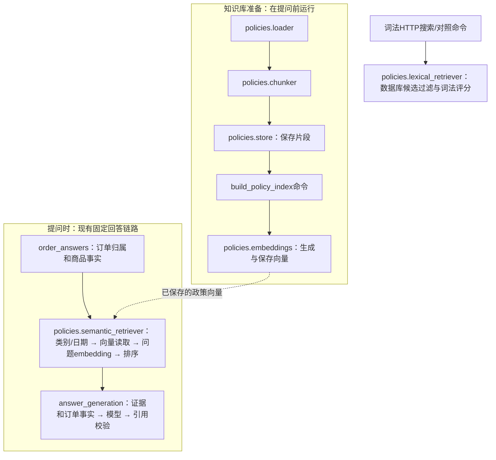

词法和语义检索仍可独立对照，当前固定回答使用语义路径；图中不表示两者已做混合排序。政策工具复用订单上下文与语义检索，不自行生成回答。

下方全局图展示现有HTTP/CLI入口；独立工具与Agent调用图见本页11月2日/3日记录。Agent图已实现并独立离线验证，HTTP/CLI仍使用固定回答链路。

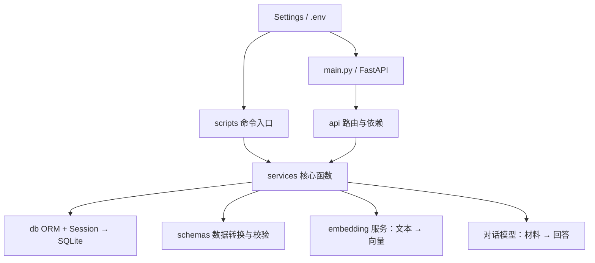

箭头表示依赖/调用关系，不表示每个函数都会访问数据库或调用模型。schemas 不负责数据库读写，scripts 不另写一套业务算法。

## 数据准备：导入政策与建立向量

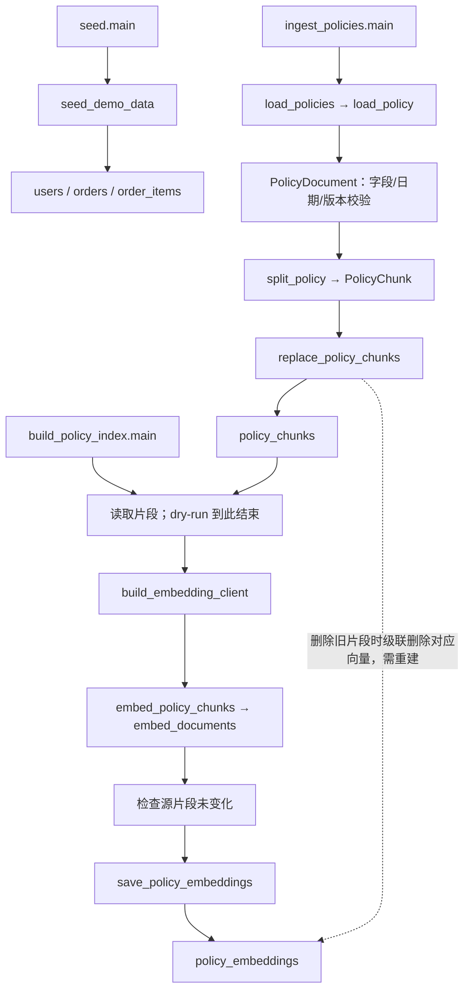

导入命令在一个事务中提交整批政策。向量构建先完成模型请求，再在一个事务中保存。核心保存函数只 flush，不 commit；提交和回滚由调用方管理。向量包含 chunk_id、model_id、dimensions、vector，每个片段当前只保存一份向量。

## FastAPI 启动和现有请求

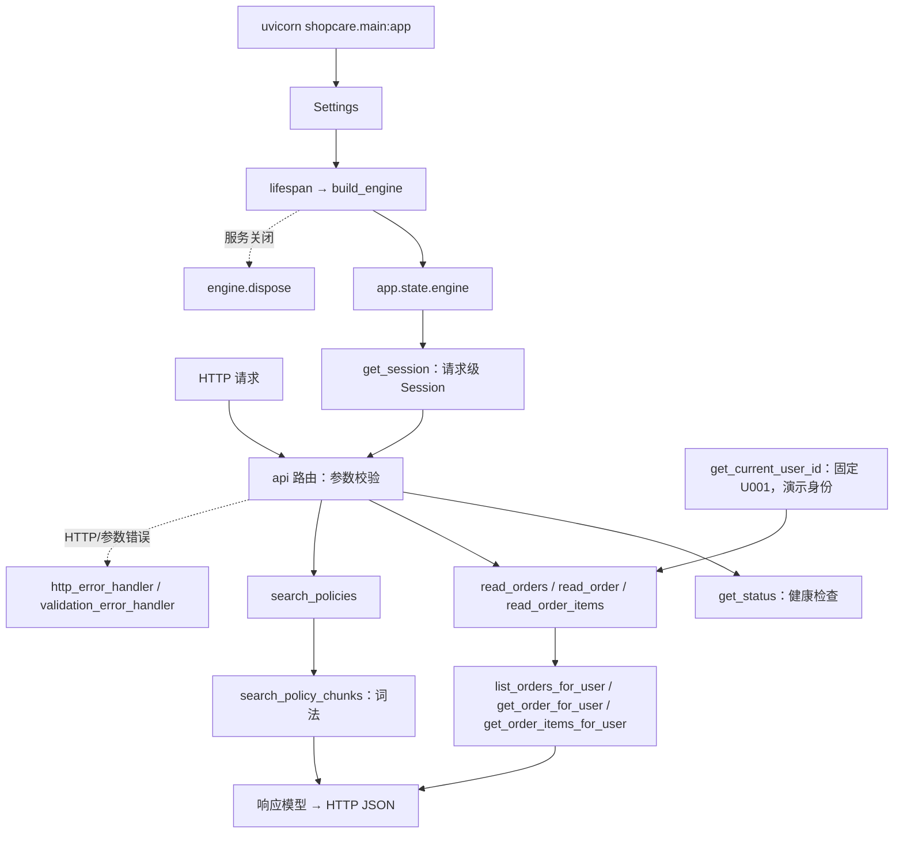

启动不会自动建表、导入数据、构建向量或调用模型。固定 U001 是演示配置，不是真实登录认证。

## 订单咨询主流程：正在接通的服务层入口

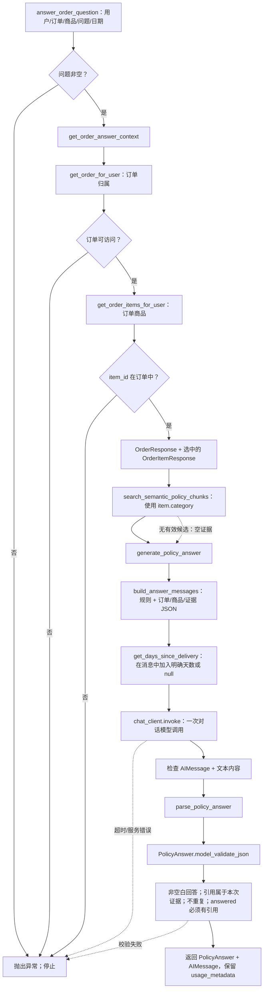

这里是固定代码顺序，尚无 Agent 自主选工具。get_order_answer_context 只准备可信事实；generate_policy_answer 只使用已准备的材料；answer_order_question 把它们与检索串起来。只有 invoke 调用对话模型，创建客户端不发送请求。当前无证据仍会进入生成函数，提示词要求说明不足，解析器拒绝无引用的 answered；不能声称代码已自动验证政策与每句结论的语义一致性。

## 两种检索的内部流程

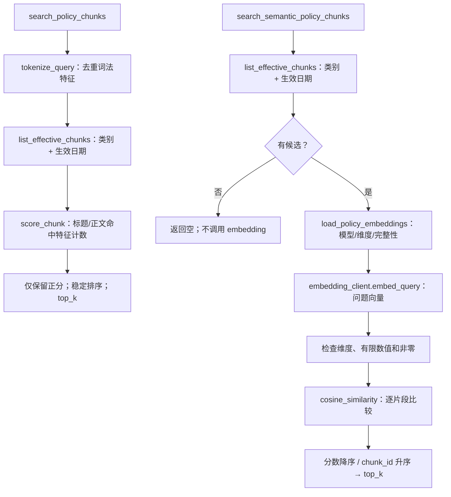

类别和有效期使用 [effective_from, effective_until)；失效日期可为空。语义检索尚无相关性阈值，因此可能向无关问题返回候选。独立 policies/filter.py 的 is_policy_effective / filter_applicable_policies 是早期内存过滤函数，当前数据库检索使用 list_effective_chunks，不重复经过它们。

## 如何运行

在 PowerShell 中切换到项目根目录；若当前显示 >>>，先用 exit() 退出 Python 交互窗口。

```powershell
Set-Location D:\VsCode\ShopCare
# 首次准备或需要补齐模拟数据时运行；已有数据通常不用重复初始化
.venv\Scripts\python.exe -m shopcare.scripts.seed
# 重新导入会清理对应旧向量，不要日常启动时反复执行
.venv\Scripts\python.exe -m shopcare.scripts.ingest_policies
# 免费本地预览；只在政策/模型/维度变化或索引缺失时正式重建
.venv\Scripts\python.exe -m shopcare.scripts.build_policy_index --dry-run
.venv\Scripts\python.exe -m shopcare.scripts.build_policy_index
# 日常启动 API
.venv\Scripts\python.exe -m uvicorn shopcare.main:app --reload --host 127.0.0.1 --port 8000
```

正式 build_policy_index 调用真实 embedding，产生用量。已有索引不需要随 API 启动重建。浏览器访问 http://127.0.0.1:8000/docs 查看实际路由；http://127.0.0.1:8000/api/health 检查服务。政策搜索仍是词法；回答服务可通过独立 answer_order CLI 或 POST /api/orders/{order_id}/answer 调用；启动 API 不自动调用回答服务。

评测另开终端，无需先启动 uvicorn：

```powershell
# 独立临时库，通过 TestClient 验证词法 HTTP 路由；不调用模型
.venv\Scripts\python.exe -m shopcare.scripts.evaluate_retrieval
# 默认预览；--run 使用真实 embedding 问题向量，读取本地索引
.venv\Scripts\python.exe -m shopcare.scripts.compare_retrieval
.venv\Scripts\python.exe -m shopcare.scripts.compare_retrieval --run
```

## 函数定位清单

包含入口、服务、校验方法和数据库连接辅助函数。新增函数应更新对应图或说明，以及此清单；不在主流程执行的函数标明为辅助或独立用途。各脚本的 main 是命令包装，并非另一套业务实现。

| Python 模块（backend/src/shopcare 下） | 当前函数/方法 |
|---|---|
| agent/graph.py | `build_agent_graph`, `validate_start`（内部）, `route_after_model`, `route_after_tools` |
| agent/nodes.py | `build_model_node`, `call_model`（内部）, `build_tool_node`, `call_tools`（内部） |
| agent/state.py | `AgentState`类型声明，无函数 |
| agent/agent.py | `prepare_conversation_turn`, `execute_conversation_graph`, `run_conversation_turn`：短事务开始、可信线程/本轮图执行、独立成功/失败收尾；已接chat_agent CLI |
| agent/prompts.py | `build_agent_messages`：构造初始系统规则与用户消息；`build_turn_reminder`：只列本轮证据的临时模型调用提醒，两个Agent CLI启用 |
| agent/results.py | `collect_policy_evidence`：提取本次成功政策工具证据；`parse_agent_answer`：完成状态/最终消息/本轮引用校验；`validate_consultation_answer`：有限的明确执行承诺拦截；`validate_policy_quotes`：片段编号/连续原文摘录校验；`parse_agent_policy_answer`：内部JSON/摘录覆盖校验后返回PolicyAnswer；均已接两个Agent CLI，未接固定HTTP |
| agent/__init__.py | 包声明，无函数、无核心调用 |
| api/dependencies.py | `get_session`, `get_current_user_id` |
| api/conversations.py | `create_conversation_api`：短事务创建；`read_conversation`：复用get_conversation_for_user按归属查询；均返回三字段ConversationResponse，已注册main |
| api/errors.py | `http_error_handler`, `validation_error_handler` |
| api/health.py | `get_status` |
| api/orders.py | `read_orders`, `read_order`, `read_order_items`, `answer_order` |
| schemas/answers.py | `OrderAnswerRequest.reject_blank` |
| api/policies.py | `search_policies` |
| db/session.py | `build_engine`, `init_db`, `enable_foreign_keys` |
| main.py | `lifespan` |
| schemas/policy_models.py | `reject_blank`, `validate_date_range` |
| scripts/build_policy_index.py | `main` |
| scripts/compare_retrieval.py | `main` |
| scripts/evaluate_retrieval.py | `main` |
| scripts/ingest_policies.py | `main` |
| scripts/seed.py | `seed_demo_data`, `main` |
| scripts/run_agent.py | `main`：默认预览、配置/客户端/只读Session、工具和图组装、回答校验与报告 |
| scripts/chat_agent.py | `main`：默认预览、新建/归属查询、SQLite保存器上下文、run_conversation_turn、结果报告及资源释放 |
| services/answer_generation.py | `build_answer_messages`, `parse_policy_answer`, `generate_policy_answer`, `get_days_since_delivery` |
| services/embeddings.py | `cosine_similarity`, `build_embedding_client` |
| services/llm.py | `build_chat_client` |
| services/order_answers.py | `get_order_answer_context`, `answer_order_question` |
| services/orders.py | `get_order_for_user`, `list_orders_for_user`, `get_order_items_for_user` |
| services/conversations.py | `create_conversation`, `get_conversation_for_user`, `start_conversation_turn`, `finish_conversation_turn`：已供多轮agent入口及chat_agent CLI使用；未接会话HTTP |
| services/policies/chunker.py | `split_policy` |
| services/policies/embeddings.py | `embed_policy_chunks`, `save_policy_embeddings`, `load_policy_embeddings` |
| services/policies/filter.py | `is_policy_effective`, `filter_applicable_policies` |
| services/policies/loader.py | `load_policy`, `load_policies` |
| services/policies/lexical_retriever.py | `list_effective_chunks`, `tokenize_query`, `score_chunk`, `search_policy_chunks` |
| services/policies/store.py | `replace_policy_chunks` |
| services/policies/semantic_retriever.py | `search_semantic_policy_chunks` |


## 单次回答演示入口（2026-10-31 新增）

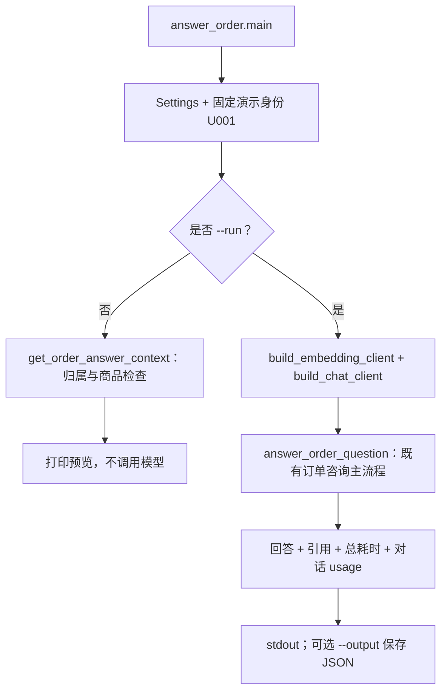

main 不实现新的问答算法，不写数据库；调用异常向 CLI 转换为失败退出，未校验回答不会保存为成功结果。as_of 默认固定 2026-11-02，是模拟场景参照日期，不是系统今天。--run 可能调用一次 embedding 和一次 qwen-plus；两者用量分开，不以对话 usage 代替总用量。构造客户端不发送请求。

新增源码函数：scripts/answer_order.py 的 main。验证说明：test_order_service.py 新增 answer_clients 测试 fixture、完整链路、选中商品类别、越权/空输入不调用模型以及 embedding 失败阻止对话测试；这些测试不进入业务运行图。

```powershell
.venv\Scripts\python.exe -m shopcare.scripts.answer_order
.venv\Scripts\python.exe -m shopcare.scripts.answer_order --run --output docs/answer-demo.json
```

验证更新：订单与回答相关 54 项离线测试通过。answer_order CLI 已实际预览并试跑；docs/answer-demo.json 为首次真实试跑原始记录，虽然格式和引用校验通过，回答的草稿动作承诺与质量问题定性尚未通过内容验收。

复测状态：提示词边界修改后，明确故障/模糊故障仍有动作承诺和状态/日期错误；天气问题返回证据不足。详见 answer-baseline.md。未新增运行函数；调用图不变，内容验收尚未完成。

第二次复测：澄清状态改善，但正文/limitations 的日期和条件仍需修正。计划在消息构造前增加日期差计算，尚未实现，当前调用图不将其画成已存在节点。最终判定见 answer-baseline.md。


## 签收日期差计算（已实现并接入消息）

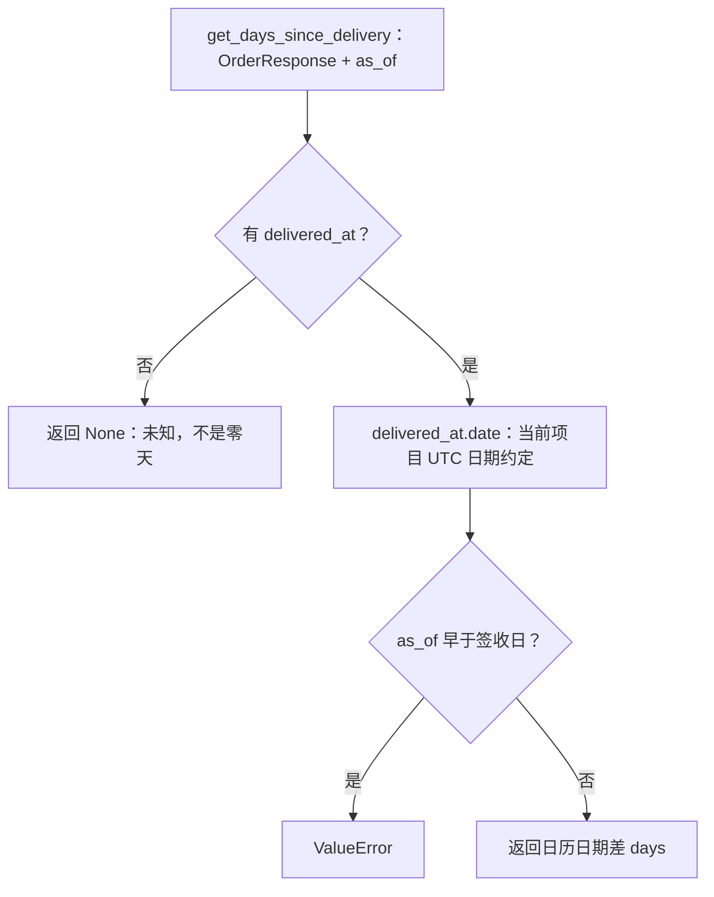

此函数不判断换货资格，也不把15日解释为具体截止时刻；已由 build_answer_messages 调用，作为 days_since_delivery 字段加入模型输入。对应现有 test_answer_generation.py 验证同日、跨月、闰年、跨年、未知签收和非法参照日期。未调用模型。

当前验收更新：日期事实已接入消息，最新“耳机坏了”一次真实复测正确澄清并引用3天事实，无日期矛盾；未复跑其余旧样例，不能宣称整个当前版本真实案例全部通过。原始失败与修订结果均保留。

## 2026-11-01｜回答请求模型（尚未接入 HTTP）

开发者新增 schemas/answers.py 的 OrderAnswerRequest 与 reject_blank 校验函数：对 item_id、query 去除首尾空白并拒绝空白值，字段声明限制长度，as_of 解析为日期，拒绝额外字段。仅进行请求数据校验，不调用核心服务、数据库或模型；尚未接入路由，不计为可用 HTTP 入口。

源码函数清单补充：schemas/answers.py — OrderAnswerRequest.reject_blank。已本地验证正常输入、空白问题、空白商品、非法日期、超长问题和额外身份字段；未调用外部模型。

## 2026-11-01｜回答 HTTP 成功路径（异常转换待实现）

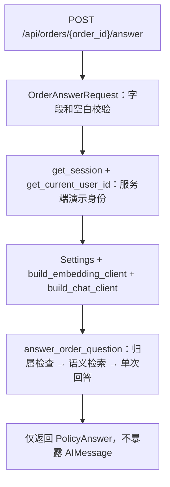

开发者新增源码函数 api/orders.py 的 answer_order，接在 HTTP 入口与现有 answer_order_question 之间，已由 orders_router 接入应用。当前仅成功路径完成；LookupError、配置/索引/输出校验错误及模型服务错误尚未转换为统一 HTTP 错误，暂未完成接口验收。身份仍为固定演示身份，不是真实认证。

助手复用 test_order_api.py 的 client fixture，新增 test_answer_api_forwards_trusted_identity_and_returns_only_answer 与 test_answer_api_rejects_invalid_body_before_clients：验证服务端身份传递、参数去空白、仅返回结构化回答、五种非法输入在构造客户端前拒绝。模拟客户端及核心返回，不调用真实模型；不据此宣称底层越权路径已完成 HTTP 验证。订单 API 文件共37项测试通过，-W error 无警告。初次运行遭遇旧测试缓存/临时目录访问限制，改用独立临时目录并关闭缓存后通过。

### 回答接口 404 验证更新

开发者已在 answer_order 将 LookupError 转为统一 404（ORDER_CONTEXT_NOT_FOUND）；主调用图不变。新增测试函数 test_answer_api_missing_unowned_and_wrong_item_return_safe_404：保留真实 answer_order_question 与归属/商品检查，仅替换外部客户端，覆盖订单不存在、他人订单、商品不属于订单。三例均返回相同错误，且 embedding.embed_query 与 chat.invoke 未调用。订单 API 共40项测试通过，-W error 无警告，相关代码及格式检查通过。客户端构造仍在 try 外，配置、索引和模型异常转换待实现；尚未完成整体接口验收。

### 回答接口上游异常验证更新

开发者在 answer_order 按顺序捕获 APITimeoutError/TimeoutError 和 OpenAIError，分别返回504 ANSWER_TIMEOUT与502 ANSWER_UPSTREAM_ERROR，采用固定对外提示。新增测试函数 test_answer_api_converts_provider_errors_without_leaking_details，模拟三种异常，验证状态、错误结构、不泄漏内部细节、不重试；不调用真实模型。订单 API 共43项测试通过，-W error 无警告。调用图不变，配置构造仍在 try 外，索引/模型输出等 ValueError 尚未处理，整体接口验收仍待完成。

### 回答接口配置错误验证更新

开发者将 Settings、embedding/chat 客户端构造置于独立 try，捕获 ValueError 返回503 ANSWER_NOT_CONFIGURED，不与回答阶段校验错误混淆。新增测试函数 test_answer_api_configuration_failure_stops_before_pipeline，模拟三个配置阶段失败，验证固定错误响应、不泄漏细节、停止后续构造和回答流程。订单 API 共46项测试通过，-W error 无警告，相关代码与格式检查通过，无真实模型调用。主调用顺序不变，回答阶段 ValueError 和数据库异常仍待处理，整体接口尚未验收完成。


## 2026-11-01｜回答 HTTP 离线验收完成

调用路径：HTTP → OrderAnswerRequest → 服务端身份/Session → 配置和客户端构造 → answer_order_question → PolicyAnswer。配置阶段ValueError转503；回答阶段LookupError转404、超时转504、OpenAIError转502、ValueError/SQLAlchemyError转500，均采用固定公开错误。配置构造优先于归属检查；日期早于签收日仍是通用500，后续可细化。历史小步记录中的待实现异常分支现已完成。

新增测试函数 test_answer_api_database_failure_is_safe_error 与 test_answer_api_real_pipeline_with_simulated_models：验证数据库异常，以及保留真实HTTP、订单事实、检索、消息构造和引用校验的正常回答/非法JSON/伪造引用/缺失索引。仅替换外部模型客户端，使用临时数据库；缺失索引不调用模型。运行函数无新增，主调用图不变。

最终离线回归346项通过，-W error 无警告；全后端Ruff与格式检查结果见当日进度。未新增真实付费调用，不把离线通过等同于语义正确或真实模型稳定；仍无Agent、记忆或售后写操作。

## 2026-11-02｜订单工具初稿审查（未验收）

新增源码函数 tools/orders.py 的 build_order_tools 与内部工具 lookup_order。工厂绑定服务端 Session/user_id，工具schema目前仅暴露order_id。预期连接：独立tool.invoke → lookup_order → services.orders.get_order_for_user → OrderResponse；尚未接HTTP或Agent，不改变已有固定回答链路。

初稿实测：空白订单号抛ValueError；正常订单号因遗漏session参数而抛TypeError。成功结果data仍为Ellipsis占位，尚未实现序列化。应由开发者补齐INVALID_ARGUMENT结构化错误、传递session和成功数据转换，之后再做隔离/错误验证。尚未运行通过工具业务测试。源码函数清单补充：tools/orders.py — build_order_tools、lookup_order（内部工具，待验收）。

### 订单工具基本行为验证通过（数据库异常待实现）

开发者已补齐空白订单号的INVALID_ARGUMENT结果、get_order_for_user(session, user_id, order_id.strip())调用，以及OrderResponse JSON序列化。助手仅整理格式并在现有test_order_service.py复用session fixture，新增test_order_tool_invocation_and_safe_output、test_order_tool_schema_and_separate_user_bindings：六项实例覆盖正常查询、去空白、两名用户、他人/不存在订单同错、公开字段与JSON序列化、仅暴露order_id及额外身份参数不切换用户。当前额外字段被框架忽略，不代表已严格拒绝额外参数。

该测试文件41项通过，-W error 无警告；使用临时库，无外部模型调用。调用关系已成立：独立tool.invoke → lookup_order → get_order_for_user → OrderResponse；仍未接Agent/HTTP。数据库异常以及缺字段/错误类型的框架校验转换尚待处理，不宣称整体工具已验收。运行函数无新增，主应用调用图不变。

### 订单工具数据库故障验证通过

开发者已在lookup_order将SQLAlchemyError转换为TEMPORARILY_UNAVAILABLE，保留固定提示，不暴露内部SQL，不自行commit/rollback/close外层Session。现有test_order_tool_database_failure_is_safe_and_keeps_transaction_ownership验证上述边界；订单服务测试文件42项通过，-W error无警告，相关Ruff和格式检查通过。缺失order_id/错误类型实测由LangChain输入校验抛ValidationError，尚未进入工具函数；后续执行层需要统一转换此类框架校验错误。当前额外参数仍被忽略，计划用显式args_schema严格拒绝。无新增运行函数，主调用关系不变。

### 订单工具显式输入模型验证通过

开发者新增schemas/orders.py的OrderLookupInput类（无新增函数），并通过@tool(args_schema=OrderLookupInput)接入lookup_order，严格字符串、长度1–100、拒绝额外字段。助手调整原先“额外身份被忽略”的测试为“额外身份被拒绝”，新增test_order_tool_rejects_invalid_schema_before_query，六项实例覆盖缺字段、数字、None、空字符串、超长值和额外user_id，均在数据库查询前抛ValidationError。订单服务文件48项测试通过，-W error无警告；无外部模型调用。tools/orders.py调用关系不变，尚未接Agent。下一步由开发者实现统一工具执行入口，转换输入校验错误与未知工具名；不应把业务执行中出现的所有ValidationError都归为输入错误。

## 2026-11-02｜统一工具执行入口已验证

开发者新增 tools/executor.py 的 execute_tool：按服务端工具注册表查找名称，未知名称返回UNKNOWN_TOOL；通过get_input_schema().model_validate单独校验输入，失败返回INVALID_ARGUMENT；invoke在该捕获块之外，避免将执行内部的数据校验错误误归为输入错误。只支持当前字典参数/字典结果的项目工具，尚未实现完整模型ToolCall/ToolMessage协议或Agent循环。

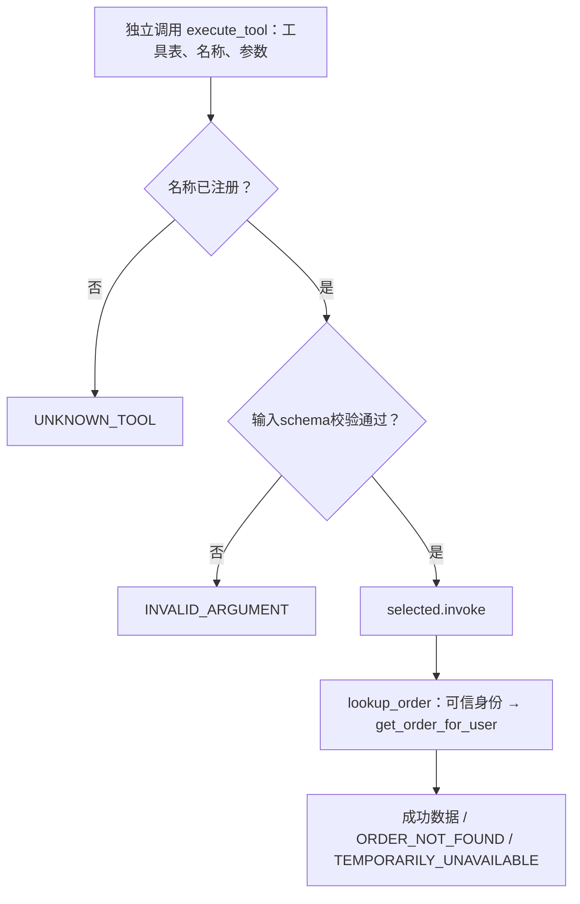

新增源码函数清单：tools/executor.py — execute_tool。新增测试函数：test_tool_executor_dispatches_real_order_tool、test_tool_executor_unknown_tool_does_not_invoke_registered_tool、test_tool_executor_converts_input_errors_before_invocation、test_tool_executor_does_not_misclassify_internal_validation_error。六项实例覆盖真实订单工具派发、越权、未知工具、三个输入错误和内部ValidationError传播。订单服务测试文件54项通过，-W error无警告；格式与代码检查通过，无模型调用。今日政策工具尚未实现，今日范围尚未完成。

## 2026-11-02｜政策工具初稿（待验收）

开发者实际创建tools/policy.py（使用单数文件名，沿用该路径），新增build_policy_tools及内部search_order_policies。参数由OrderPolicySearchInput声明，仅order_id/item_id/query；可信user_id/as_of/session/embedding_client由工厂绑定。调用关系：独立tool.invoke → get_order_answer_context归属/商品检查 → search_semantic_policy_chunks（类别取自商品）→候选证据。未接Agent/HTTP。

初稿审查：调用顺序与类别来源正确，但当前直接返回list[SemanticPolicySearchHit]，与dict注解及统一ok/data协议不符；空白字段未统一拒绝、订单商品编号未strip、归属及检索异常尚未转换。模拟空检索实测返回裸列表[]，工具参数只有order_id/item_id/query；无真实数据库或模型调用。需由开发者补结果序列化和输入/错误边界，尚未验收。助手仅整理本轮代码格式。源码函数清单新增：tools/policy.py — build_policy_tools、search_order_policies。

### 政策工具基本结果验证通过（身份编号去空白与异常处理待补）

开发者已增加三个字段的空白拒绝、统一ok/data返回及SemanticPolicySearchHit的JSON序列化；空结果按成功空列表处理。助手复用tests/services/policies/test_semantic_retriever.py的engine/client fixture，新增test_policy_tool_blank_fields_do_not_access_context_or_search（三项）及test_policy_tool_uses_bound_date_and_item_category_and_serializes（两项）：覆盖空白字段不查询、绑定日期和商品类别、实际语义检索服务、JSON日期序列化、无候选不调用embedding。上下文查询使用模拟返回，完整归属链路尚待补测。该文件26项测试通过，-W error无警告，格式与代码检查通过，无真实模型调用。

仍需由开发者修正get_order_answer_context调用的order_id/item_id去空白；目前仅query去空白。LookupError、数据库/模型服务/索引校验错误尚未转换为工具错误。无新增运行函数，主调用图不变，政策工具尚未整体验收。


## 2026-11-02｜只读工具阶段离线验收完成

本节更新此前逐步审查中的待实现状态：订单工具、严格参数schema、政策工具和统一执行入口均已实现并验证。新增运行函数清单：tools/orders.py的build_order_tools、lookup_order；tools/policy.py的build_policy_tools、search_order_policies；tools/executor.py的execute_tool。新增输入类OrderLookupInput、OrderPolicySearchInput不定义额外函数，tools/__init__.py仅声明包。

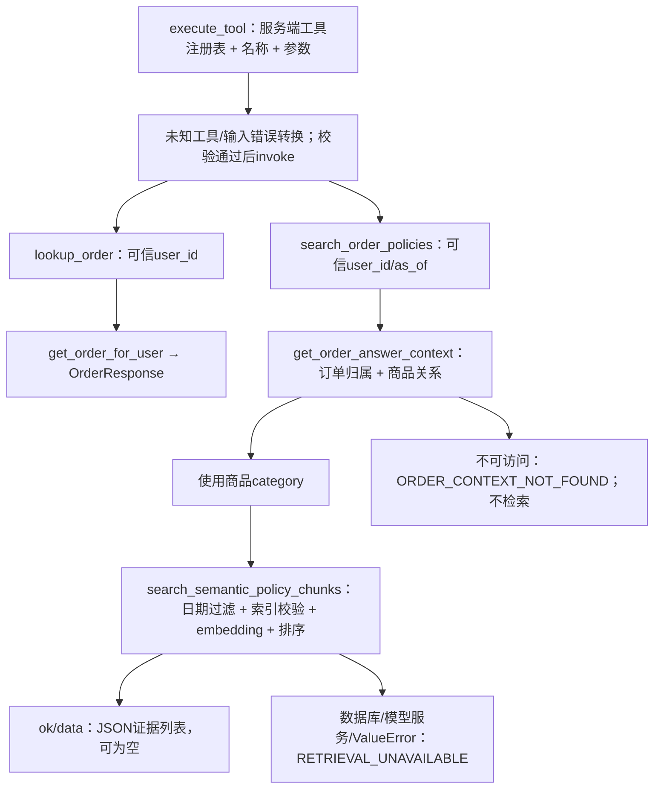

助手新增验证函数test_policy_tool_executor_real_ownership_and_retrieval、test_policy_tool_denied_context_never_embeds、test_policy_tool_executor_rejects_untrusted_context_and_bad_input、test_policy_tool_failures_are_safe_and_never_call_chat及其内部故障注入辅助函数fail_context。均属测试，不进入业务运行图。复用既有临时库和answer_clients fixture，验证真实归属、两个商品类别、编号去空白、严格拒绝身份/日期/类别覆盖、模型/索引/数据库故障，不调用对话模型。

完整离线回归384项通过，-W error无警告；全后端Ruff通过，61个Python文件格式检查通过。本轮无真实模型调用，不以离线结果宣称实际模型选工具已验证。工具未接入HTTP、Agent或会话；仅支持项目内dict参数/结果，尚非完整ToolCall/ToolMessage执行器。工具不接管事务；数据库故障后由外层处理Session。检索失败错误未细分可重试性，不能自动无限重试。运行与目录职责不因新增工具而复制核心业务逻辑。


## 2026-11-02｜政策目录重组

用户明确要求按领域整理平铺目录。助手移动七个政策服务及对应七个测试模块至policies子目录，文件名去掉重复policy前缀，policy_retriever改为lexical_retriever；原函数与模型不变，业务代码与测试仅更新导入。新增services/policies/__init__.py仅声明包，无函数，不调用核心服务。无新增业务或测试函数；函数清单上方已按新路径更新。

修改引用覆盖API、CLI、固定回答服务、政策工具和测试；原HTTP路径与CLI模块入口不变。不保留旧Python导入兼容层，本仓库外若手工使用旧模块名需要更新。本次不修改数据库或调用真实模型。该段覆盖前文“保留原目录”的历史说明；最终验证结果见当日进度。

## 2026-11-03｜Agent状态声明完成，模型节点待实现

开发者新增agent/state.py的AgentState类，声明messages的add_messages合并规则、model_calls/tool_calls计数、stop_reason。助手验证模块导入、类型字段及两个消息的合并行为，并通过该文件Ruff与格式检查；无外部模型调用，无新增业务函数。AgentState仅声明状态，不调用既有核心函数，不表示图已可运行，当前HTTP/CLI仍使用原固定链路。

接下来计划由开发者新增agent/nodes.py中的build_model_node及内部call_model：绑定既有工具schema并根据当前messages调用对话模型，返回消息增量与调用次数；模型工具请求执行由后续工具节点复用execute_tool。该计划尚未实现，不画入现有运行调用图。

## 2026-11-03｜模型节点初稿审查（预算判断待修正）

开发者新增agent/nodes.py的build_model_node及内部call_model。工厂通过chat_client.bind_tools绑定工具schema；预期模型节点读取消息，调用模型，返回单条消息增量、model_calls+1和running/completed状态。模型节点不执行工具、不直接查数据库。尚未组装Graph或接入HTTP/CLI。

初稿实测：用普通dict状态和模拟客户端调用，预算判断state.model_calls > max.model_calls触发AttributeError，未进入invoke。应使用state["model_calls"] >= max_model_calls，在达到而非超过上限时阻止请求。助手仅整理格式，预算逻辑由开发者修正；模型异常及响应校验尚待实现。本轮无真实模型调用，尚未通过节点行为验收。新增源码函数清单：agent/nodes.py — build_model_node、call_model（内部函数）。

### 模型节点成功路径与预算边界通过

开发者已修正state字典取值及>=预算判断。助手新增backend/tests/agent/test_nodes.py，调用build_model_node并模拟bind_tools/invoke，新增测试函数test_model_node_returns_message_increment_without_mutating_state、test_model_node_exhausted_budget_never_invokes_model，共六项实例覆盖直接回答/工具请求、首轮/最后允许一次调用、达到/超过上限不invoke、返回消息增量且不原地修改状态。六项通过，-W error无警告，相关Ruff与格式检查通过；无数据库或真实模型调用。

运行函数无新增，尚未接图。剩余：异常及非AIMessage/invalid_tool_calls处理；失败请求也需计入调用预算，以尝试次数限制运行。尚未实现的模型/工具循环不计为可用入口。新增测试文件只做验证、不调用核心业务服务，工具执行仍由后续节点复用execute_tool。

### 模型节点失败尝试计数与响应校验通过

开发者在call_model计入调用尝试next_calls，捕获OpenAIError/TimeoutError返回failed；非AIMessage或存在invalid_tool_calls也终止且不追加异常消息。助手新增测试函数test_model_node_failed_attempt_counts_and_does_not_append_response，五项实例覆盖超时、API超时子类、上游服务异常、错误消息类型、无法解析的工具请求。节点测试共11项通过，-W error无警告，相关Ruff与格式检查通过；无真实模型调用。函数调用关系不变，仍未组装Graph。工具节点及条件路由待开发；模型预算配置和初始状态运行边界将在组装入口一并校验。

## 2026-11-03｜工具节点初稿（返回状态待补）

开发者新增agent/nodes.py的build_tool_node及内部call_tools：读取最后AIMessage、检查整批工具预算、循环调用execute_tool并构造对应tool_call_id的ToolMessage。助手整理导入与缩进，仅使用模拟execute_tool试跑一次合法调用：执行器已调用一次，但call_tools末尾未返回状态，实际返回None，工具结果及计数无法写回图状态，尚未通过节点验收。

新增源码函数清单：agent/nodes.py — build_tool_node、call_tools（内部函数）。预期调用关系：call_tools → execute_tool → 已注册工具 → services；ToolMessage加入messages后才交回模型节点。尚未组装Graph，调用编号/输出大小/故障中断及空消息防护待补；本轮无真实工具或模型服务调用。

### 工具节点返回状态与整批预算验证通过

开发者已补齐call_tools返回messages增量、tool_calls按本批派发次数增加和running状态。助手在既有test_nodes.py新增test_tool_node_returns_matching_messages_and_counts_batch、test_tool_node_rejects_entire_batch_over_budget、test_tool_node_rejects_messages_without_tool_requests，共六项实例：两请求的消息ID/JSON结果/顺序、成功和未知工具结果、刚好用完预算、整批超额零执行、无工具请求消息拒绝、不修改原状态。节点文件共17项通过，-W error无警告，相关代码和格式检查通过，无真实工具/模型调用。

仍需处理空messages、缺失/空白/重复工具调用ID、执行异常、基础设施错误终止和输出大小；完整图尚未组装。函数调用图不变，本次仅补已有函数的行为验证。

### 工具节点整批编号预检通过

开发者在读取末条消息前检查空列表，并在执行任何工具前拒绝缺失、非字符串、空白或重复的调用ID。助手新增test_tool_node_rejects_invalid_call_ids_before_any_execution，六项实例覆盖空历史及畸形ID，第二个请求不合法时第一个也不执行，证明预检发生在整批派发前。节点测试共23项通过，-W error无警告，相关Ruff与格式检查通过；无真实外部调用。仅增加验证，无新增运行函数，Graph尚未组装。

### 工具节点失败中断与结果大小限制完成（用户授权助手直接修改）

用户明确要求本次由助手直接完成，并持续授权已讲清方案的同类局部修正；已记录AGENTS.md。助手修改agent/nodes.py的call_tools，不新增运行函数：派发前增加尝试次数，捕获执行/序列化异常并failed终止；非字典结果拒绝；JSON禁止NaN；单条序列化结果按max_output_chars字符限制，超限丢弃该条而不截断JSON；基础设施错误TEMPORARILY_UNAVAILABLE/RETRIEVAL_UNAVAILABLE保留对应ToolMessage后终止余下请求。之前成功的结果与尝试次数保留，原state不变，不输出内部异常详情。

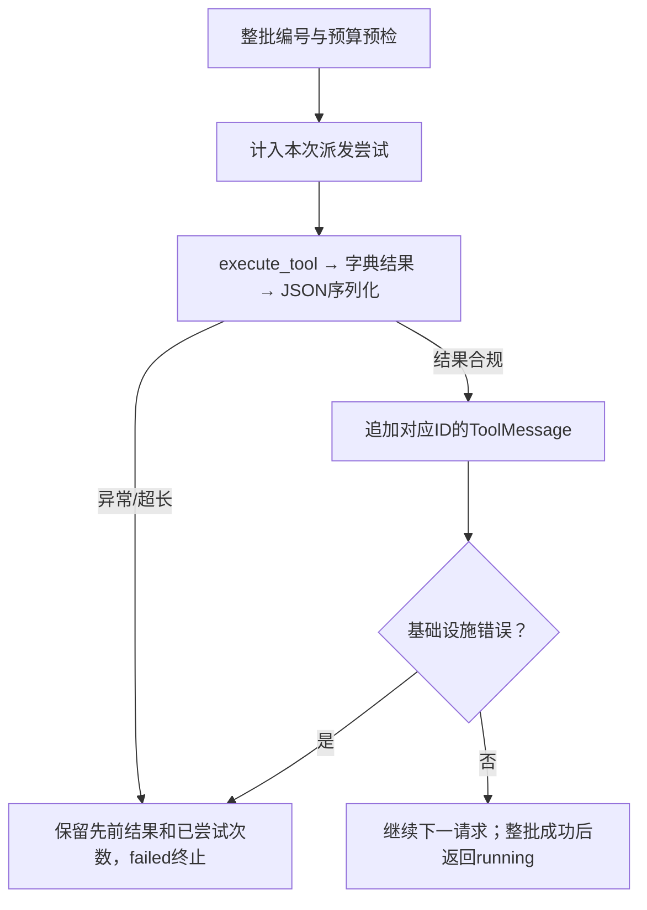

新增测试函数：test_tool_node_stops_on_unusable_output_and_counts_attempt、test_tool_node_infrastructure_failure_returns_error_and_skips_remaining_tools、test_tool_node_output_size_boundary_is_serialized_character_count、test_tool_node_retains_completed_results_before_later_failure。十二项实例覆盖执行异常/不可序列化/NaN/非字典/超长、两个基础设施错误、中文JSON字符长度刚好/超出边界、后续失败保留此前结果。节点测试共35项通过，-W error无警告，相关Ruff及格式检查通过，无数据库/外部模型调用。

当前失败状态可能保留未获结果的工具请求，后续Graph必须直接END，不得继续发模型或将其当成可恢复会话；当前不支持持久化恢复。字符限制是单条JSON输出限制，不是总token预算或总历史大小限制。仅节点独立验证完成，Graph及条件路由尚未实现，今日范围尚未完成。


## 2026-11-03｜有界Agent图离线验收完成

前文逐步记录中的“尚未组装Graph”属于当时状态，以本节及页首为当前状态。开发者实现route_after_model、route_after_tools及build_agent_graph基本连接。助手按局部修正持续授权补正整数配置/工具实例/重名校验、内部validate_start、模型预算耗尽后不再派发工具，以及随预算调整图recursion_limit；新增agent/__init__.py只声明包。编排逻辑复用已验收的节点工厂和工具，不复制业务查询或检索。

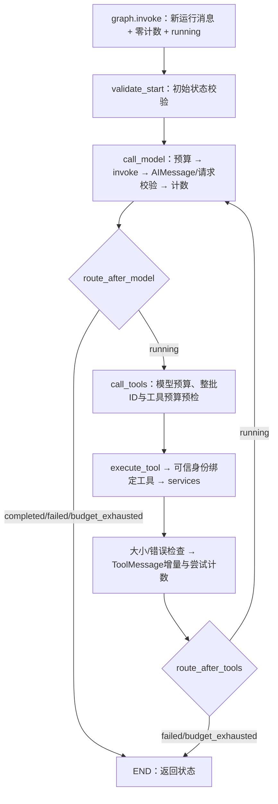

完整运行入口：agent.graph.build_agent_graph(...).invoke(state)，配置和示例见README。只接受零计数的新运行，不支持恢复、checkpointer、HTTP会话；失败末态不得直接续传模型。配置在bind_tools前校验，初始状态在invoke模型前校验。输出为AgentState消息历史及终止原因，尚未接PolicyAnswer解析器，不能将completed等同于引用有效或回答正确。

新增测试文件backend/tests/agent/test_graph.py调用build_agent_graph、build_order_tools、build_policy_tools、seed_demo_data/build_engine/init_db等既有函数，用临时数据库及模拟embedding/chat客户端；无真实付费请求。测试辅助函数graph_context、initial_state、tool_request，以及两个局部reply提供模拟响应。新增测试函数：test_graph_selects_next_tool_from_prior_result_and_finishes、test_graph_direct_answer_skips_tools、test_graph_tool_error_is_visible_to_next_model_call、test_graph_model_budget_stops_before_unusable_last_tool_batch、test_graph_tool_budget_stops_without_partial_batch、test_graph_model_failure_ends_without_more_requests、test_graph_tool_failure_never_sends_incomplete_history_to_model、test_graph_rejects_invalid_limits_before_binding_model、test_graph_rejects_duplicate_tool_names、test_graph_rejects_invalid_initial_state_before_model_call、test_graph_large_model_budget_uses_matching_graph_step_limit。纯验证函数不混入运行图。

Agent相关67项、完整后端451项测试通过，-W error无警告；全后端Ruff通过，68个Python文件格式检查通过。已验证模拟模型根据第一次订单结果决定下一政策工具；不是实际模型工具选择评测。本轮无真实模型调用、不写演示库。工具输出上限是单条字符限制，通用failed暂不提供详细事件原因；当前无结构化最终回答校验、真实Agent试跑、会话或记忆。当天有界循环范围收口。

## 2026-11-04｜Agent初始消息构造完成

开发者新增agent/prompts.py的build_agent_messages(query, as_of)，仅构造消息，无已有核心函数调用。助手修正HumanMessage误放系统规则导致query丢失的问题，将服务端as_of写入SystemMessage，并补齐JSON字段类型、状态含义及证据/事实边界。返回顺序为SystemMessage、HumanMessage；用户原始问题原样保留。

当前位置：独立调用方 → build_agent_messages → list[BaseMessage]。后续调用方计划将消息写入AgentState交给既有图；目前尚无运行入口接线，不改变graph内部调用图。最终PolicyAnswer解析和引用来源校验尚未实现。

验证：直接导入并断言消息数量、类型、用户问题保留和两个不同日期的正确注入；相关Ruff及格式检查通过。无新增测试文件、外部模型调用或数据库操作。提示词生效程度未做真实模型验证。

## 2026-11-04｜政策工具证据提取完成

用户明确要求助手完成本函数。助手实现agent/results.py的collect_policy_evidence(messages)，不调用已有业务函数；仅使用消息类型、json.loads及SemanticPolicySearchHit.model_validate。独立调用链为：本次可信运行消息 → AIMessage请求编号/工具名登记 → ToolMessage按编号匹配并消费 → 仅政策结果解析 → 成功data逐项校验 → list[SemanticPolicySearchHit]。失败结果和成功空结果不提供证据；损坏JSON、异常包结构、非法证据或未完成请求编号冲突抛ValueError。无对应请求、重复结果、订单结果和普通文本不贡献证据。消费后的编号可在后续请求重新使用，匹配遵循消息顺序。

此函数只处理服务端本次运行产生的可信消息，不对任意客户端提交历史做来源认证；不检查整段对话是否完整或已成功终止，也不替代未来的最终回答/状态校验。尚未接图、HTTP/CLI或parse_policy_answer，不改变现有运行图。

助手新增backend/tests/agent/test_results.py，调用collect_policy_evidence与证据模型校验，13项实例通过，-W error无警告；相关Ruff及格式检查通过。测试函数test_collect_policy_evidence_matches_ids_and_ignores_other_messages、test_collect_policy_evidence_failure_or_empty_result、test_collect_policy_evidence_rejects_malformed_policy_result、test_collect_policy_evidence_rejects_ambiguous_request_ids仅记录于验证说明。无外部模型调用、数据库操作或整库回归。

## 2026-11-04｜Agent最终回答解析独立验收完成

开发者新增agent/results.py的parse_agent_answer(state)。助手按局部修正持续授权，将TypedDict属性访问改为字典取值、统一未定义的messages/last_message变量，并将整次工具执行计数判断改为最终AIMessage的tool_calls/invalid_tool_calls检查。零工具调用的澄清/证据不足回答可正常解析；仅允许stop_reason为completed、消息非空、末条为无工具请求的AIMessage且content为文本。复用collect_policy_evidence及services.answer_generation.parse_policy_answer，返回PolicyAnswer，不新增模型调用或业务查询。

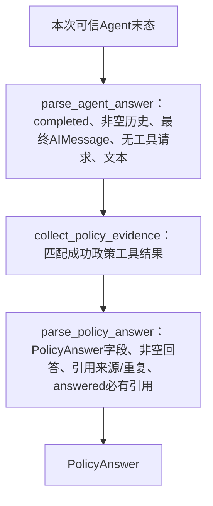

本图表示可独立调用的解析链；当前HTTP/CLI尚未接入。测试已将build_agent_messages → build_agent_graph.invoke → parse_agent_answer串联，以临时数据库、真实项目工具和模拟外部模型验证；不表示新增正式运行入口。该解析器依赖本次服务端可信图结果，不认证客户端自造历史，不验证所有历史协议、全部业务语义或政策资格；澄清状态涉及政策解释但无引用的旧限制仍然存在。

在既有测试文件补test_parse_agent_answer_accepts_direct_answer_without_tool_calls、test_parse_agent_answer_rejects_unfinished_run、test_parse_agent_answer_rejects_unusable_final_message、test_parse_agent_answer_applies_existing_answer_validation，以及test_graph_final_answer_is_validated_against_actual_policy_results。覆盖正常直答、三种非完成状态、空历史/末条错误/工具请求/非文本、非法JSON/空白回答及工具实际结果对应的有效/伪造/重复/缺失引用。Agent相关99项通过，-W error无警告；相关Ruff及格式检查通过，无真实模型调用或演示数据库修改。本步未新增Python文件。

## 2026-11-04｜独立Agent演示命令

助手新增scripts/run_agent.py的main，调用Settings、get_current_user_id、build_engine、build_embedding_client、build_chat_client、build_order_tools、build_policy_tools、build_agent_messages、build_agent_graph及parse_agent_answer。命令复用核心实现，不新增业务算法。输入为问题、模拟参照日期、预算和可选输出路径；用户身份固定由可信演示依赖提供。默认只做输入/文件存在检查，不打开库、不构造客户端、不写报告。--run才打开Session并启用SQLite query_only，绑定工具、调用图和解析器；Session/Engine由命令关闭/释放，不初始化或写业务数据。

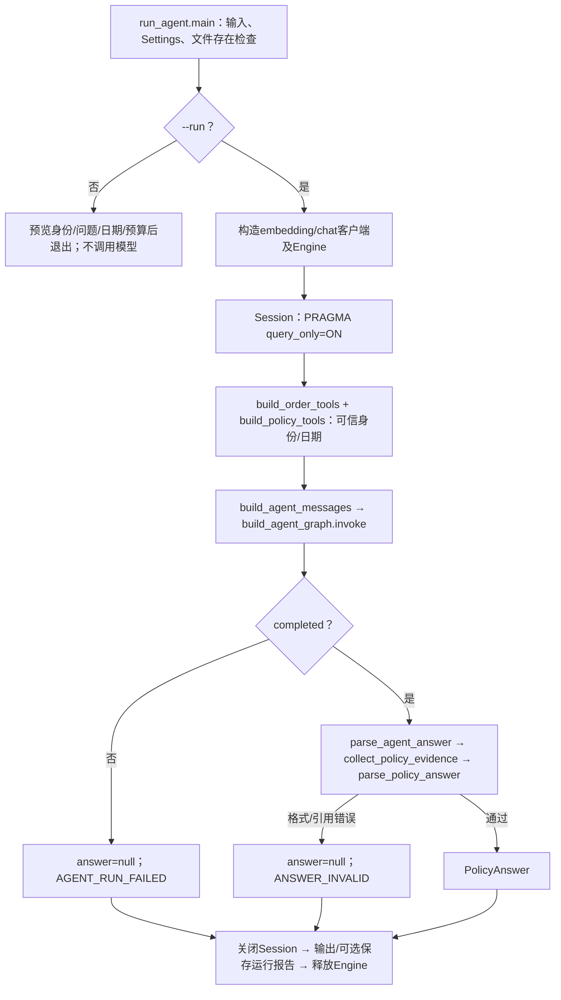

默认3次模型、4次工具派发尝试、单条工具JSON12000字符；问题向量调用不超过工具预算，可能因无候选/无工具请求为0，不伪报实际embedding次数。报告只记录工具请求名/编号、图终态与尝试数、模型返回usage和最终校验答案；无原始订单/消息/私有思考。失败图和回答校验失败报告仍可保存并返回进程码1；输入/配置等图运行前故障只给通用错误。解析失败不重试模型。模型/工具状态与回答的status含义分别保持。

新增测试文件backend/tests/scripts/test_run_agent.py，调用main及已有数据库初始化/模拟数据服务，使用临时库与模拟外部客户端。测试fixture agent_cli_context负责构造环境；测试函数test_preview_never_constructs_clients_opens_database_or_writes_report、test_invalid_input_fails_before_client_construction、test_cli_runs_real_tools_and_validates_final_answer_without_database_writes、test_cli_failed_run_or_answer_is_saved_as_failure、test_missing_database_is_not_created、test_database_session_rejects_accidental_writes（内部attempt_write）验证预览零调用、输入边界、真实工具和图/解析链、错误报告、用量缺失、数据库不自动创建和只读保护。纯验证函数不接运行图。

11月4日最终离线验收：完整后端496项、Agent相关99项、演示命令13项通过，-W error无警告；全后端Ruff及73个Python文件格式检查通过，本地默认预览通过。本轮无真实模型调用、未修改演示数据库；结构与引用来源通过不能替代全部内容审查。当前主调用关系以页首和本节独立CLI图为准，前文“未接入口”等为当时逐步开发记录。

## 2026-11-05｜Conversation会话模型独立验证

开发者在db/models.py新增Conversation类，声明conversations表：id、user_id、thread_id、as_of、status、created_at、updated_at；user_id外键指向users且有索引。助手补__table_args__单元素元组末尾逗号与thread_id唯一约束。按用户要求，字段保持与文件前面类一致的多行mapped_column结构，保留参数换行与末尾逗号，不压缩为单行。

该模型不新增运行函数、不调用业务服务，不保存消息正文。现有init_db通过Base.metadata.create_all可创建此表；本次仅在临时库验证，没有修改本地演示数据库，也没有接会话服务、Graph checkpoint或HTTP/CLI。当前可验证关系为init_db → 注册ORM模型 → 临时库创建conversations表；真实多轮调用图尚未变化。

复用backend/tests/db/test_db.py的engine fixture，新增测试辅助make_conversation，以及test_conversation_persists_across_connections、test_conversation_rejects_missing_user、test_conversation_thread_id_is_unique_across_users、test_conversation_rejects_invalid_status_or_missing_required_fields。覆盖三个合法状态的重连读取、用户外键、跨用户thread_id唯一和非法状态/必填字段；更新新进程建表测试的表清单。数据库测试49项通过，-W error无警告；相关Ruff及格式检查通过。纯测试函数仅列于本验证说明，不放入业务运行图。

## 2026-11-05｜创建会话服务独立验收

开发者新增services/conversations.py的create_conversation(session, user_id, as_of)。助手仅整理空格/空行、明确user is None判断并补参数尾逗号，保留多行函数签名与Conversation构造。函数不调用已有核心服务，使用Session.get(User, user_id)检查用户，缺失抛LookupError；分别生成两个UUID4作为外部会话id与内部thread_id，使用同一个UTC无时区时间填created_at/updated_at，初始status为ready，session.add/flush后返回Conversation。调用方负责commit/rollback/close，flush会触发Session中其他待写入记录的刷新，不能视为仅写当前对象。

当前独立链：调用方的Session/可信用户/参照日期 → create_conversation → 检查User → 构造Conversation → add/flush → 返回ORM记录。尚无会话查询/状态领取、HTTP/CLI或Graph/checkpoint接线；会话创建不代表已保存聊天历史。未修改演示数据库、未调用外部模型。

助手新增backend/tests/services/test_conversation_service.py，调用create_conversation、build_engine/init_db及模型；fixture conversation_engine仅管理临时库。test_create_conversation_generates_distinct_ids_and_persists验证两名用户的编号/参照日期、UUID4、时间一致和调用方提交后重连读取；test_create_conversation_does_not_commit_callers_transaction验证会话及此前待提交用户均可回滚；test_create_conversation_missing_user_leaves_session_usable验证未知用户无会话写入，调用方仍可继续创建合法会话。3项通过，-W error无警告；相关Ruff及格式检查通过，未重跑完整后端。纯验证函数不进入运行图。

## 2026-11-05｜按用户归属查询会话独立验收

开发者新增services/conversations.py的get_conversation_for_user(session, user_id, conversation_id)，查询同时限制Conversation.user_id及Conversation.id。助手直接修正session.scalars返回结果集合的问题，改用session.scalar返回单个ORM对象或None，移除对结果集合的无效真值判断；保留查询条件多行布局。未知会话、未知用户和他人会话统一None；不按status过滤，不变更会话状态/时间，不自行提交事务。

独立调用链：可信用户身份及会话编号 → get_conversation_for_user → SELECT（编号与归属同时匹配）→ Conversation或None。后续执行入口应在拿到记录后才能访问其thread_id；当前尚未访问checkpoint或接HTTP/CLI，模型不能选择内部thread_id。未新增Python文件或外部调用。

在既有test_conversation_service.py增加test_get_conversation_for_user_returns_record_without_changing_status、test_get_conversation_for_user_hides_foreign_and_missing_records，覆盖ready/running/failed读取及元数据不变、其他用户/未知用户/未知编号；已有回滚测试加入查询操作，验证查询不会提交调用方事务。会话服务9项通过，-W error无警告，相关Ruff及格式检查通过，均用临时库。

## 2026-11-05｜Graph可选checkpoint接线独立验证

开发者为build_agent_graph新增checkpointer: BaseCheckpointSaver | None = None并传入graph.compile，保持原有预算/路由与默认无保存器入口。助手仅整理导入位置、空行及compile/with_config多行缩进。保存器资源由外层提供并管理，图工厂不创建/关闭SQLite连接、不决定会话归属。

在现有test_graph.py增加test_graph_sqlite_checkpoint_survives_reopening_and_appends_new_turn和test_graph_sqlite_checkpoint_separates_thread_histories：临时SQLite保存一次运行，关闭并重新打开saver/重新构图后get_state恢复原消息；使用相同内部thread_id、仅本轮HumanMessage及零计数/running输入，历史追加为两轮且本轮model_calls为1。不同thread_id不读取另一线程历史。图测试38项通过，-W error无警告；相关Ruff及格式检查通过，无外部模型调用或演示数据库修改。

当前可独立使用关系：调用方管理SqliteSaver上下文 → build_agent_graph(checkpointer=saver) → compile(checkpointer) → 图按configurable.thread_id保存/加载。此机制测试不代表应用层安全会话入口已完成；现有CLI仍未传保存器。每轮清零输入由后续可信执行服务负责，不能让客户端覆盖线程编号/状态或直接恢复失败历史。当前没有状态领取/并发门禁或本轮证据范围处理，不能将原始图当作可公开恢复接口。新增checkpoint测试函数仅记录于验证说明，无新增Python文件/运行函数。

## 2026-11-05｜开始会话轮次的条件更新独立验收

开发者新增services/conversations.py的start_conversation_turn(session, user_id, conversation_id)。复用get_conversation_for_user，未知或越权抛LookupError；UPDATE同时匹配会话id、user_id及ready状态，设置running和UTC更新时间，rowcount不为1抛RuntimeError，禁止running/failed会话再次开始。使用synchronize_session=False后refresh ORM对象。助手修正返回数据库CursorResult的问题，改为返回刷新后的Conversation，整理空格和尾逗号，保持多行参数/条件布局。

独立调用链：start_conversation_turn → get_conversation_for_user → 归属错误时LookupError / 条件UPDATE ready→running → 行数检查 → refresh → Conversation。函数不commit/rollback/close；后续外层必须先提交领取事务，再进行模型调用，避免在模型请求期间持有业务库写锁。本步尚未连接Graph、保存器或HTTP/CLI；不会自动从running恢复为ready。

在既有test_conversation_service.py增加test_start_conversation_turn_returns_refreshed_running_record、test_start_conversation_turn_rejects_non_ready_record、test_start_conversation_turn_rejects_missing_or_foreign_record、test_start_conversation_turn_does_not_commit_callers_transaction、test_start_conversation_turn_allows_only_one_concurrent_caller，测试内部辅助lookup_before_race/attempt_start。并发测试使用两个线程的独立Session，两方均先读到ready后再竞争更新，验证恰好一次成功、一次RuntimeError；这是本地SQLite特定竞争场景验证，不宣称全面负载测试。会话服务17项通过，-W error无警告；相关Ruff及格式检查通过，无真实模型调用、仅临时库，未新增Python文件。

## 2026-11-05｜结束会话轮次独立验收

开发者新增services/conversations.py的finish_conversation_turn(session, user_id, conversation_id, *, succeeded)。仅接受bool，复用get_conversation_for_user检查归属、缺失/越权抛LookupError；条件UPDATE仅匹配当前用户的running会话，按succeeded更新为ready/failed及UTC时间，无更新抛RuntimeError。refresh后返回Conversation，由调用方管理事务。助手仅整理空格/缩进、补参数尾逗号，并将结束阶段的状态错误说明明确为“会话当前没有正在执行的轮次”，保持多行参数和SQL布局。

当前独立会话状态闭环为create_conversation → ready → start_conversation_turn → running → finish_conversation_turn(succeeded=True) → ready，或succeeded=False → failed。failed不允许再次start。这里的succeeded由后续可信执行入口在图正常结束且回答解析通过后决定，不能由客户端声称成功。当前没有实际图执行入口调用这一闭环；进程中途崩溃可能留下running，尚无自动恢复/超时解锁或完成操作的幂等重试承诺。

既有test_conversation_service.py新增test_finish_conversation_turn_persists_result_and_controls_next_turn、test_finish_conversation_turn_rejects_non_running_record、test_finish_conversation_turn_rejects_missing_or_foreign_record、test_finish_conversation_turn_rejects_non_boolean_outcome、test_finish_conversation_turn_does_not_commit_callers_transaction。覆盖成功/失败持久化及下一轮准入、ready/failed不被重复结束、越权/不存在、非布尔参数和调用方回滚。会话服务29项通过，-W error无警告；相关Ruff及格式检查通过，无新增Python文件、外部调用或演示库修改。

## 2026-11-05｜准备会话轮次的事务入口独立验收

开发者实际创建agent/agent.py（沿用此路径，先前runner.py为计划文件名，未创建），实现prepare_conversation_turn(engine, user_id, conversation_id) -> tuple[str, date]。助手仅整理空格/空行及多行调用尾逗号。函数自己管理Session与session.begin事务，调用start_conversation_turn，在事务内取得thread_id/as_of，正常退出事务提交running后返回普通值；归属/状态/提交错误向上抛出并由上下文回滚。避免返回已关闭Session中的ORM对象，也避免让业务写事务跨越后续模型请求。

当前独立关系：prepare_conversation_turn → 短Session/事务 → start_conversation_turn → get_conversation_for_user/条件UPDATE → 取出线程/日期 → 提交并关闭Session → tuple。函数尚不加载checkpoint或执行模型；只能由后续会负责结束状态的可信执行入口调用，单独调用成功会保留running，不具备自动解锁或崩溃恢复。

助手新增backend/tests/agent/test_agent.py，调用prepare_conversation_turn、create_conversation和build_engine/init_db；fixture turn_context仅管理临时库。test_prepare_turn_commits_running_and_returns_plain_values、test_prepare_turn_rejects_inaccessible_conversation、test_prepare_turn_rejects_non_ready_conversation、test_prepare_turn_rolls_back_when_commit_fails（内部reject_commit，通过Session.before_commit模拟故障）共7项通过，-W error无警告；相关Ruff及格式检查通过。覆盖提交后新连接可见running、不同用户/未知会话、running/failed拒绝、提交前故障回滚且后续仍可取得执行权。无模型调用或演示数据库修改，尚未接HTTP/CLI。

11月5日多轮提示规则补充：build_agent_messages增加“本轮政策说明重新检索、引用仅来自本轮成功结果”的系统规则。函数调用关系不变，无新增函数。该提示配合计划中的execute_conversation_graph本轮消息切分使用；执行函数和完整多轮入口仍未实现，不能将提示修改视为硬校验已接通。相关消息构造检查及Ruff/格式检查通过，无模型调用。

11月5日导入与文件位置修正：开发者将execute_conversation_graph初稿写入prompts.py，并导入同文件的build_agent_messages，造成自身循环导入。助手保留已写的工具/图构造，将执行函数移至既定agent/agent.py，补齐该文件当前和后续步骤的依赖，修正build_aget_graph拼写及多行缩进；prompts.py仅保留消息构造及其所需导入。两个模块直接导入成功，无模型请求；prompts的完整Ruff、agent的导入顺序及两文件格式检查通过。execute_conversation_graph仍未完成，尚有待使用的导入/局部graph变量，不宣称执行函数完整lint或功能验收；未加载历史、invoke或返回PolicyAnswer，不供运行入口调用。

## 2026-11-05｜多轮Graph执行步骤独立验收完成

用户明确授权补全execute_conversation_graph。继续时源码主体已经完整，本轮保留现有实现并补测试验收，不重复重写核心逻辑。函数验证保存器、非空内部线程及1–1000字符问题，绑定可信用户/参照日期的订单/政策工具，使用build_agent_graph(checkpointer=...)构图。get_state按内部线程读取；snapshot.next非空拒绝继续，已有状态需有消息和用户消息，并仅截取最近HumanMessage起的上一轮历史，通过parse_agent_answer检查。不会用更早轮次证据替上一轮的无效引用兜底。

本轮输入仅有新的HumanMessage，首轮才通过build_agent_messages加入系统消息；调用计数清零、stop_reason设running。图返回完整历史后复制状态字典，按此前history_count切出本轮新增消息，再调用parse_agent_answer。模型可看旧上下文，引用只允许来自本轮匹配的成功工具结果。函数使用而不提交/关闭调用方Session和保存器，不验证外部会话编号归属，不自行start/finish；内部thread_id/user_id/as_of必须由未来的可信外层入口提供。

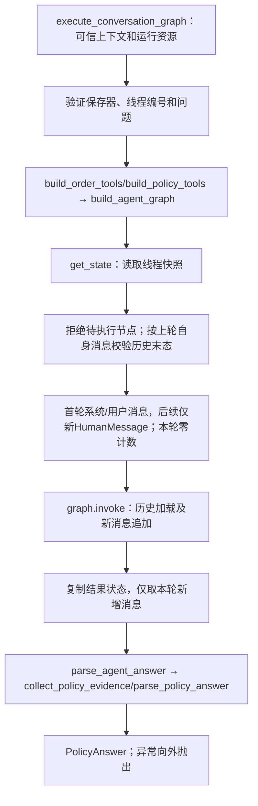

在既有backend/tests/agent/test_agent.py补conversation_graph_context、policy_request、answer_message测试辅助，以及test_execute_graph_restores_history_and_uses_real_tools_for_new_turn、test_execute_graph_rejects_old_citation_and_cannot_reuse_invalid_saved_answer、test_execute_graph_rejects_failed_run_and_blocks_following_model_call、test_execute_graph_rejects_checkpoint_with_pending_node、test_execute_graph_validates_input_before_binding_model。该文件20项通过，-W error无警告；相关Ruff和格式检查通过。

测试使用临时业务/检查点数据库、真实工具/检索服务、模拟chat/embedding，覆盖关闭并重新打开保存器和Engine连接后两轮对话、上下文不重复、每轮计数重置、Session资源保留、实际政策引用、旧引用拒绝及不合规历史续用阻止、对话超时/检索失败/非法JSON/预算终止、未完成节点和输入错误。未做新操作系统进程重启或真实模型效果验证，无演示库写入；本轮未新增Python文件。完整run_conversation_turn的状态提交/异常收尾以及CLI/HTTP入口仍待实现，图执行步骤独立通过不代表外部会话入口完成。

## 2026-11-05｜完整轮次入口与持久化CLI

开发者实现run_conversation_turn初稿。助手按局部修正授权补执行失败后重新raise，避免继续走成功收尾；在prepare前检查保存器和问题，防止无效输入改变会话状态。执行失败时使用新事务finish(False)，再抛出原异常；失败收尾也失败时，为原异常追加可能仍为running的说明。成功收尾放在图执行try/except之外，提交失败直接报错，不二次修改状态或返回有效答案。保存器及Engine由外层提供，函数管理内部短Session，不关闭调用方资源。

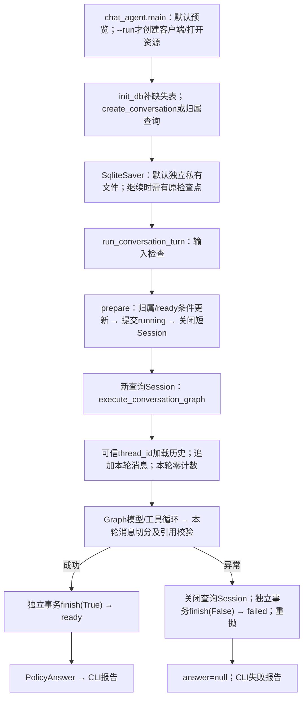

助手新增scripts/chat_agent.py的main，复用Settings、客户端工厂、get_current_user_id、build_engine/init_db、create_conversation/get_conversation_for_user及run_conversation_turn。默认只检查输入/数据库文件，不创建客户端/打开数据库/写报告；--run补缺失表并创建/继续会话，保存检查点及可选JSON报告。会话编号对外，内部线程只从已验证归属的记录取出；日期创建后固定，恢复禁止覆盖，检查点文件不能与业务库相同。恢复命令发现线程检查点不存在会拒绝继续，状态不变。会话/模型开始前的配置或归属错误只给通用错误；运行错误报告返回1，终态无法读取用null。既有HTTP/answer_order及单次run_agent入口保持原行为。

在test_agent.py新增run_context、first_reply测试辅助和test_run_turn_commits_before_model_and_returns_ready_for_next_turn、test_run_turn_marks_failure_and_blocks_following_request、test_run_turn_rejects_bad_input_before_changing_status、test_run_turn_rejects_inaccessible_conversation_before_checkpoint、test_run_turn_rejects_non_ready_conversation_without_finishing_it、test_run_turn_preserves_original_error_if_failure_status_cannot_be_saved、test_run_turn_does_not_return_answer_or_finalize_twice_if_success_finish_fails。模型回调中另一个连接可读到running并完成独立写事务，验证未持有领取写锁；覆盖输入、归属/状态、超时/检索/JSON/预算/构图失败和两种收尾故障。

新增backend/tests/scripts/test_chat_agent.py，fixture chat_cli_context及测试test_chat_preview_does_not_open_database_or_create_clients、test_chat_cli_creates_and_continues_same_conversation、test_chat_cli_rejects_invalid_input_before_creating_clients、test_chat_cli_failed_answer_reports_failure_and_cannot_continue、test_chat_cli_cannot_continue_another_users_conversation、test_chat_cli_rejects_missing_checkpoint_without_starting_a_fresh_history验证CLI预览、新建/继续、参数、失败、归属及错误检查点路径。

test_agent.py新增test_chat_cli_continues_in_new_python_process：使用subprocess启动两个独立Python解释器，第一轮澄清后进程退出，第二进程用相同conversation_id/检查点库读回两条用户消息，并使用真实政策工具检索、通过本轮引用校验。只替换外部chat/embedding客户端，业务数据库、保存器、CLI与图均真实执行；未调用真实模型或操作演示库。纯测试函数不加入运行图。

边界：这不是任意中断节点恢复或运行中崩溃自动重试；独立会话表与checkpoint库不是一个原子事务，可能留下running，当前人工处理。未做历史裁剪/摘要、长期记忆、会话HTTP或售后申请。先前逐步记录中的“尚未接完整入口/CLI”等以本节与页首当前状态为准。

11月5日最终验收：完整后端586项通过，-W error无警告；Agent编排test_agent.py 38项、会话服务29项、多轮CLI8项；全后端Ruff及79个Python文件格式检查通过。本地默认预览通过，两个独立Python进程的真实CLI/服务/保存器恢复验证通过，外部模型均为Mock，无真实模型效果声明。前文各开发阶段的未完成描述为当时状态，当前以页首及本节完整轮次/CLI关系为准。

## 2026-11-07｜Agent订单事实补入签收天数

本次未新增运行函数。build_order_tools(session, user_id, as_of)现绑定服务端参照日期，单次run_agent.main与多轮execute_conversation_graph均显式传入同一as_of；模型只可提供order_id，不能覆盖日期。

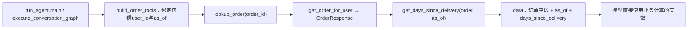

未知签收返回null，非法先于签收的参照日期返回结构化错误；不判断换货资格，不修改订单，不接入新的HTTP字段。源码函数清单中的build_order_tools/lookup_order新增上述依赖，get_days_since_delivery复用于工具与固定回答两条链路。

新增测试函数test_order_tool_returns_server_computed_delivery_days（4组）和test_order_tool_refuses_reference_date_before_delivery，验证0/3/16日、未知日期、客户端覆盖日期拒绝及非法参照日期。现有图集成测试断言模型下一次调用前已收到3天和服务端日期。相关233项离线测试通过；真实样例首轮日期修正，第二轮沿用旧引用被拒绝。引用来源校验不是全部业务语义校验，真实两轮闭环尚未验收。

## 2026-11-07｜第二轮引用纠正与明确办理承诺拦截

- 新增运行函数仍在原文件：agent/prompts.py的build_turn_reminder读取最近HumanMessage之后的真实政策工具结果，复用collect_policy_evidence，返回本轮允许引用ID及咨询边界的临时SystemMessage。每次模型请求追加，但不把临时提醒写入checkpoint，不修改传入历史。
- agent/results.py新增validate_consultation_answer，位于parse_policy_answer之后，检查answer和limitations中的明确中文办理承诺/已执行声称，保留否定说明与政策描述。采用有范围的文字模式，不是完整语义或全部语言的能力判定器；固定HTTP回答流程未接此新检查。
- build_model_node/build_agent_graph增加validate_answers=False选项，保留原始图默认行为；正式run_agent CLI及execute_conversation_graph显式启用。无工具请求的候选先切分本轮消息并parse_agent_answer；校验失败且有剩余额度时保存候选AIMessage及通用SystemMessage反馈，再纠正。每次实际请求都累计model_calls，共用原3次额度，不额外扩大工具预算；超时立即失败。最后仍不合规由外层解析拒绝，run_conversation_turn标failed。
- 若候选需要政策说明/引用且本轮没有成功证据，下一次纠正用bind_tools(..., tool_choice="search_order_policies")明确要求检索；模型仍负责根据上下文填写参数，execute_tool及政策工具继续校验归属。未绕过归属校验、未自动拼接或猜测订单号。提供方若忽略tool_choice，最终仍无法用旧引用通过校验。
- 启用校验时，为每次AI候选分配独立消息ID，避免重复提供方ID使add_messages覆盖候选、破坏反馈顺序。无效候选和反馈保留在checkpoint供审查，最终一条必须有效；历史加载时仍重新校验上一轮最终结果。未新增Agent节点、状态字段或Python文件。

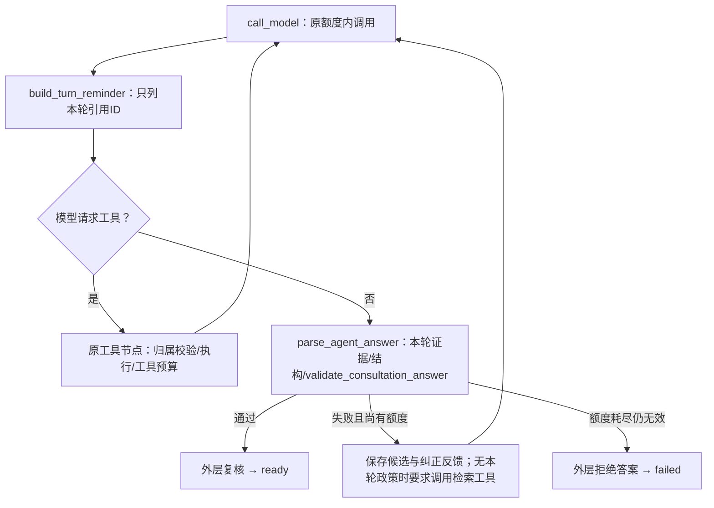

新增验证函数：test_consultation_boundary_rejects_execution_promises、test_consultation_boundary_allows_negation_and_policy_description、test_turn_reminder_excludes_old_evidence_and_does_not_modify_history、test_model_node_corrects_execution_promise_within_original_budget、test_execute_graph_repairs_stale_citation_with_fresh_tools_within_turn_budget。覆盖正文/limitations承诺、否定表述、旧证据排除、超时/持续无效、真实临时工具与关闭重开保存器后的三次额度内纠正；更新原测试对最多3次纠正的预期。这些仅属于验证，不是新增业务入口。

真实回归先确认仅提示仍会连续沿用旧引用并被拦截；增加明确tool_choice后，同一会话的两个独立CLI进程均返回ready，首轮澄清、次轮answered。次轮3次模型调用、1次成功的本轮search_order_policies，引用digital-exchange:v2:000；签收天数为3，明确不能创建/提交申请。该样例不证明普遍准确率；原始答复仍有政策未提供的“平台审核”措辞，对质量问题的表述也应继续保持条件性，未宣称完整内容验收。

## 2026-11-09｜PolicyQuote数据模型独立验收

新增数据类schemas/answers.py的PolicyQuote，字段chunk_id/quote均为非空字符串，禁止额外字段并去除首尾空白。不定义运行函数、不调用已有业务函数；只是后续政策原文摘录校验的数据结构，尚未加入PolicyAnswer、Agent输出或HTTP响应，当前运行图不变。

验证补入既有test_answer_generation.py：test_policy_quote_trims_whitespace_and_preserves_original_text、test_policy_quote_rejects_blank_fields_and_extra_data，连同原测试35项通过。纯测试函数不加入业务运行图。下一步validate_policy_quotes仅为计划，尚未实现，不加入当前源码函数清单。

## 2026-11-09｜政策原文摘录校验函数独立验收

新增运行函数agent/results.py的validate_policy_quotes(quotes: list[PolicyQuote], evidence: list[SemanticPolicySearchHit]) -> None，当前仅可独立调用：调用方传入本轮证据 → 建立chunk_id到text映射 → 逐项检查摘录编号存在及quote属于对应text的连续子串 → 正常返回None或抛ValueError。它不调用业务服务、模型或数据库。尚未接parse_agent_answer、模型提示、纠正或HTTP/CLI，当前Agent主流程不变；摘录原文匹配不代表回答语义正确。

验证辅助quote_evidence及测试test_validate_policy_quotes_accepts_exact_excerpts、test_validate_policy_quotes_rejects_unknown_or_changed_excerpt、test_validate_policy_quotes_requires_evidence_for_nonempty_quotes位于既有test_results.py，共9组新增情形；连同test_answer_generation.py共89项通过。纯测试函数不加入业务运行图。

后续计划增加内部AgentPolicyAnswer(PolicyAnswer)的policy_quotes字段，以承载模型提供的摘录；该类尚未实现，不作为当前可用能力。现有对外PolicyAnswer不增加字段，接入时仍需明确引用与摘录覆盖规则、失败纠正和旧checkpoint处理。

## 2026-11-09｜AgentPolicyAnswer内部模型独立验收

开发者在schemas/answers.py新增AgentPolicyAnswer(PolicyAnswer)，继承status/answer/citation_chunk_ids/limitations，另有必填policy_quotes: list[PolicyQuote]。该类不定义运行函数，不调用业务服务；尚未用于真实模型请求和最终解析。原PolicyAnswer四字段结构保持不变。

测试辅助test_agent_answer_parses_quotes_and_can_keep_public_answer_format、test_agent_answer_requires_valid_quote_list位于既有test_answer_generation.py，验证内部JSON字段及可显式排除policy_quotes后调用原parse_policy_answer；连同test_results.py共93项通过。仅验证模型结构及转换可行性，不表示实际入口已完成接入。

下一步计划先独立增加parse_agent_policy_answer(content, evidence)，负责JSON→内部模型→摘录校验→引用/摘录编号集合一致→对外PolicyAnswer，尚未实现，不加入当前运行函数清单。现有parse_agent_answer、提示、纠正与checkpoint检查接线前需协调格式版本；不在本步直接切换入口。

## 2026-11-09｜带原文摘录的JSON解析独立验收

新增运行函数agent/results.py的parse_agent_policy_answer(content: str, evidence: list[SemanticPolicySearchHit]) -> PolicyAnswer。输入为模型JSON及调用方提供的本轮证据，成功返回原四字段PolicyAnswer，结构/摘录/覆盖/引用任一失败抛ValueError，不访问数据库或模型。仍未接parse_agent_answer，故当前CLI/HTTP运行关系不变；独立函数不执行validate_consultation_answer，该检查仍在外层parse_agent_answer。

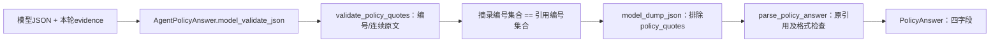

新增测试test_parse_agent_policy_answer_returns_public_format、test_parse_agent_policy_answer_rejects_invalid_quote_coverage，10组情形，连同相关模型/解析测试103项通过。尚需同步新模型提示、节点纠正解析、旧checkpoint处理和正式调用连线，不能把独立验证当成整体接入。真实摘录不保证回答语义由摘录支持。

## 2026-11-09｜原文摘录校验正式接入Agent（离线验收）

本节更新前面独立实现步骤的状态：parse_agent_answer已调用parse_agent_policy_answer，再调用validate_consultation_answer。两个正式Agent CLI经现有模型节点的validate_answers=True启用同一检查；提示要求AgentPolicyAnswer五字段，模型节点在原调用额度内纠正摘录/格式/引用错误，最终返回PolicyAnswer四字段。collect_policy_evidence与execute_conversation_graph的本轮消息切分不变，历史不是本轮证据。

```mermaid
flowchart TD
    ENTRY["run_agent / chat_agent → 图与本轮消息"] --> MODEL["call_model：五字段提示/本轮证据提醒"]
    MODEL --> CANDIDATE["parse_agent_answer：完成状态/最终AIMessage/collect_policy_evidence"]
    CANDIDATE --> JSON["parse_agent_policy_answer：AgentPolicyAnswer"]
    JSON --> QUOTE["validate_policy_quotes：本轮编号与连续原文"]
    QUOTE --> IDS["摘录编号集合 == citation_chunk_ids集合"]
    IDS --> PUBLIC["去除内部policy_quotes → parse_policy_answer"]
    PUBLIC --> BOUNDARY["validate_consultation_answer"]
    BOUNDARY --> ANSWER["PolicyAnswer：既有四字段"]
    JSON -->|校验异常且有剩余额度| RETRY["保存反馈并纠正；缺本轮证据时要求检索"]
    RETRY --> MODEL
```

上述纠正适用于整个解析链抛出的ValueError，额度耗尽后仍拒绝无效答案。节点为决定tool_choice而读取候选四字段时允许排除内部摘录字段，不代表最终回答可省略摘录；最终仍由parse_agent_answer严格验收。chat_agent对归属已验证的ready旧会话预检，历史最终JSON缺policy_quotes时提示新建且不领取/改状态、不改历史；其他不合规历史仍由底层重验拒绝。

新增验证函数test_graph_corrects_invalid_excerpt_with_current_evidence_within_budget、test_chat_cli_refuses_legacy_answer_before_starting_and_preserves_history；扩展既有失败状态验证覆盖持续错误摘录。全量647项通过，Ruff与79文件格式检查通过。新版真实模型试跑被自动审批在执行前拦截，待用户明确同意具体数据目的地后才进行；不存在新版真实效果通过记录。固定HTTP仍走原回答链路。

## 会话HTTP请求结构（尚未接路由）

schemas/conversations.py已新增ConversationCreateRequest，只定义as_of字段并拒绝额外字段，不调用现有核心函数。直接验证必填日期、非法日期及客户端身份/线程/状态覆盖拒绝，相关Ruff与格式检查通过。会话HTTP仍未接线，不加入当前运行图；计划的ConversationResponse尚未实现。

## 会话HTTP响应结构（尚未接路由）

schemas/conversations.py新增ConversationResponse，使用from_attributes从ORM读取id/status/as_of，状态类型限定ready/running/failed，不定义运行函数。直接验证公开字段白名单和未知状态拒绝，未连接数据库。下一步api/conversations.py的创建路由仍为计划，main未注册，当前运行图不变。

## 会话HTTP创建接口（已注册并验证）

本节替代前面请求/响应模型步骤中“尚未接路由”的状态。api/conversations.py新增create_conversation_api，main注册conversations_router，POST /api/conversations通过可信演示用户与Session依赖调用已有create_conversation；只接收as_of，返回201及id/status/as_of，服务端生成用户归属与内部线程映射。

```mermaid
flowchart LR
    HTTP["POST /api/conversations"] --> REQUEST["ConversationCreateRequest + 可信user_id + Session"]
    REQUEST --> TX["session.begin短事务"]
    TX --> CREATE["create_conversation：检查用户/UUID/ready/flush"]
    CREATE --> RESPONSE["ConversationResponse：id/status/as_of"]
    RESPONSE --> COMMIT["事务成功提交"]
    COMMIT --> RETURN["201 JSON"]
    TX -->|LookupError / SQLAlchemyError| ROLLBACK["事务回滚 → 安全404 / 503"]
```

新运行函数清单已补create_conversation_api；schemas/conversations.py只有请求/响应数据类，不定义运行函数。GET查询和消息推进仍为计划，创建不会初始化checkpoint或调用模型。

新增测试文件backend/tests/api/test_conversation_api.py，client复用现有API测试的临时库/lifespan模式及已有建表/种子函数；四个测试函数与参数化共10组，覆盖持久化/身份/白名单/非法请求/用户缺失/flush与commit失败回滚。辅助fail_after_flush/fail_commit属于测试。所有API和会话服务共108项通过，未请求模型或写演示库。

## 会话HTTP创建与按归属查询（当前接口）

api/conversations.py新增read_conversation并已随main注册的conversations_router生效。GET /api/conversations/{conversation_id}接收外部会话编号，身份来自get_current_user_id，复用get_conversation_for_user双条件查询。可返回ready/running/failed会话的三字段ConversationResponse，不写库、不改变updated_at，也不访问checkpoint；未知/越权统一404 CONVERSATION_NOT_FOUND，数据库故障503且不返回内部异常。

```mermaid
flowchart LR
    HTTP["GET /api/conversations/{conversation_id}"] --> DEPS["get_session + get_current_user_id"]
    DEPS --> SERVICE["get_conversation_for_user：user_id与conversation_id同时匹配"]
    SERVICE -->|记录存在| RESPONSE["ConversationResponse：id/status/as_of → 200"]
    SERVICE -->|None：不存在或越权| NOTFOUND["统一404 CONVERSATION_NOT_FOUND"]
    SERVICE -->|SQLAlchemyError| UNAVAILABLE["503 CONVERSATION_UNAVAILABLE"]
```

新增测试test_read_conversation_returns_owned_record_without_changing_it、test_read_conversation_missing_and_unowned_return_identical_404、test_read_conversation_database_failure_returns_safe_503，9组查询情形，与创建10组合计19组。它们属于HTTP验证，不增加业务图节点。旧章节所写查询未接入已由本节更新；发送消息及会话Graph HTTP尚未实现，创建记录不等于已经运行Agent。
