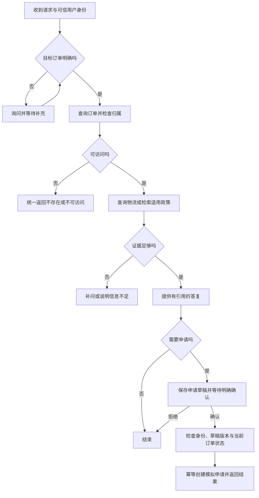

# ShopCare 需求说明

## 1. 项目目标与边界

使用者是购买商品后咨询订单、物流与售后的消费者。系统整合订单查询与政策检索，在信息不足时澄清问题，依据证据解释处理方案，并在明确确认后创建模拟售后申请。

本项目仅使用模拟用户、订单与自编政策，不连接真实商家、支付或退款系统。政策中的时限由样例文档定义，不代表任何商家的实际承诺或法律结论。

## 2. 核心场景

| 场景 | 用户示例 | 必要信息 | 预期结果 |
| --- | --- | --- | --- |
| 查询订单 | 我的耳机发货了吗？ | 可信用户身份、目标订单 | 返回订单与物流状态；订单不明确时询问 |
| 换货咨询 | 耳机左边没声音，能换吗？ | 目标订单、问题描述、签收时间、适用政策 | 引用适用政策作答，信息不足时澄清 |
| 退货申请 | 这件衣服我想退掉 | 目标订单、商品、原因、适用政策 | 生成草稿，明确确认并重新校验后提交 |

暂不支持通用购物推荐、支付、自动退款、任意 SQL、任意文件访问及自动执行用户代码。

## 3. 职责边界

- 模型理解诉求、提出澄清问题、选择允许的工具并总结工具结果。
- 程序校验参数、确定当前用户、检查订单归属、计算金额和维护业务状态。
- 当前用户来自可信服务上下文；请求正文或模型工具参数中的用户 ID 不能充当授权凭证。
- 政策结论必须有本次检索得到的适用证据，不得编造文档、引用或处理结果。
- 正式申请必须由绑定的用户明确确认；确认后重新检查版本、订单状态和资格。
- 重复确认或重试不得创建重复申请。过期草稿、状态变化或版本不一致时拒绝提交并解释。
- 记忆用于补充沟通偏好与历史摘要；订单事实始终以业务数据库为准。

## 4. 业务流程



## 5. 首批验收案例

这些是目标行为，不表示对应功能已经实现。

| ID | 场景与前置条件 | 用户输入示例 | 预期行为 | 禁止行为 |
| --- | --- | --- | --- | --- |
| A01 | 当前用户拥有指定订单 | 查询订单 O001 | 返回该订单允许展示的信息 | 编造金额、商品或状态 |
| A02 | 订单属于其他用户 | 查询订单 O999 | 返回订单不存在或不可访问 | 泄露订单内容或是否真实存在 |
| A03 | 当前用户有两笔耳机订单 | 我的耳机发货了吗 | 只展示当前用户候选订单并询问 | 猜测订单或展示别人的订单 |
| A04 | 输入的订单号不存在 | 查询订单 O404 | 返回订单不存在或不可访问 | 编造记录或调用写操作 |
| A05 | 订单符合样例换货政策 | 耳机有质量问题，可以换吗 | 引用生效政策解释资格，必要时补问 | 未确认就创建正式申请 |
| A06 | 订单明确不符合样例政策 | 我想换货 | 引用政策解释不符合的条件 | 擅自承诺换货或退款 |
| A07 | 缺少适用政策或关键事实 | 这个商品可以退吗 | 询问缺失信息或说明证据不足 | 以无关、过期政策作确定结论 |
| A08 | 已生成待确认草稿 | 不申请了 | 不创建正式申请，记录取消或拒绝状态 | 将拒绝解释为确认 |
| A09 | 草稿属于当前用户且仍有效 | 确认提交指定草稿 | 重新校验并创建一笔模拟申请 | 绕过归属、版本或状态检查 |
| A10 | 同一草稿已成功提交 | 再次确认同一草稿 | 返回已有申请结果 | 创建第二笔申请或重复副作用 |

后续评测扩展恢复、工具故障、长期记忆与并发场景。

## 6. 接口草案

健康、订单列表、订单详情和独立商品项接口已实现，其余按功能阶段开发。业务接口复用服务层，Agent 工具不得另写一套权限规则。

| 方法 | 路径 | 用途 |
| --- | --- | --- |
| GET | /api/health | 健康检查 |
| GET | /api/orders | 当前用户订单列表 |
| GET | /api/orders/{order_id} | 当前用户订单详情 |
| GET | /api/orders/{order_id}/items | 当前用户订单的商品项列表，按需读取 |
| GET | /api/orders/{order_id}/logistics | 物流信息 |
| POST | /api/conversations | 创建并绑定会话 |
| POST | /api/conversations/{conversation_id}/messages | 发送消息并推进会话 |
| POST | /api/after-sales/drafts/{draft_id}/confirm | 明确确认指定草稿版本 |

确认草稿的接口设计阶段还需明确草稿版本与幂等键的传递方式，不仅依赖自然语言“好”。

## 7. 错误约定

业务错误响应目标结构：

```json
{
  "error": {
    "code": "ORDER_NOT_FOUND",
    "message": "订单不存在或不可访问"
  }
}
```

| 情况 | 目标 HTTP 状态 | 错误码示例 |
| --- | --- | --- |
| 输入不符合 schema | 422 | VALIDATION_ERROR |
| 订单或会话不存在、不可访问 | 404 | ORDER_NOT_FOUND / CONVERSATION_NOT_FOUND |
| 草稿过期、版本或业务状态冲突 | 409 | DRAFT_CONFLICT |
| 外部模型或工具暂不可用 | 503 | DEPENDENCY_UNAVAILABLE |

错误正文不包含密钥、数据库异常原文或其他用户的信息。FastAPI 默认校验响应尚未统一为此结构，业务接口阶段实现相应异常处理。
